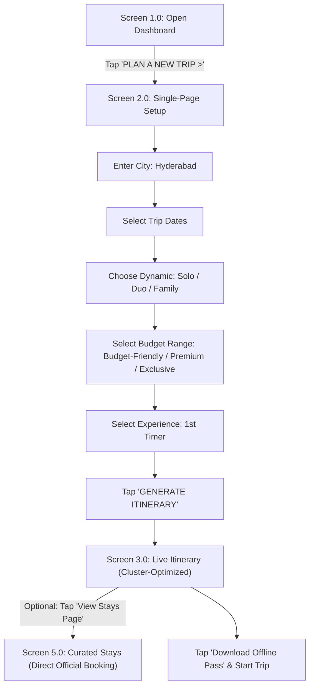
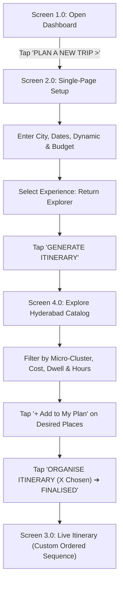
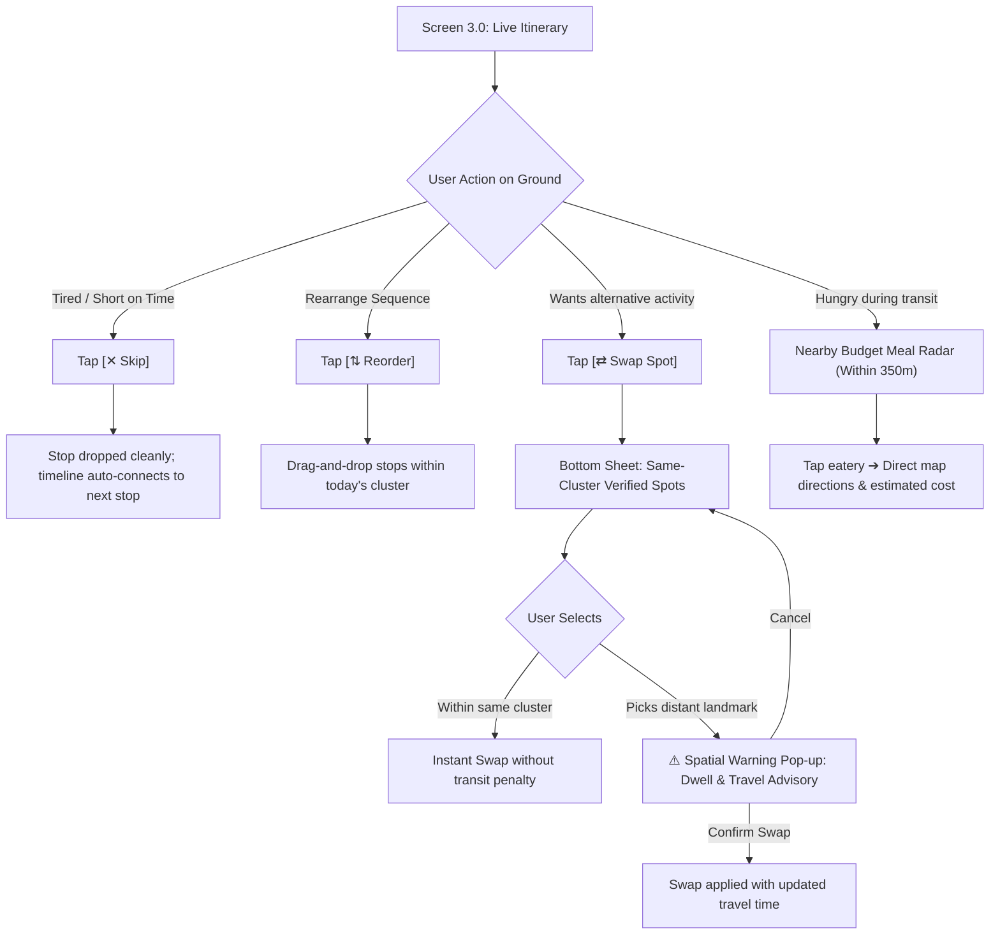
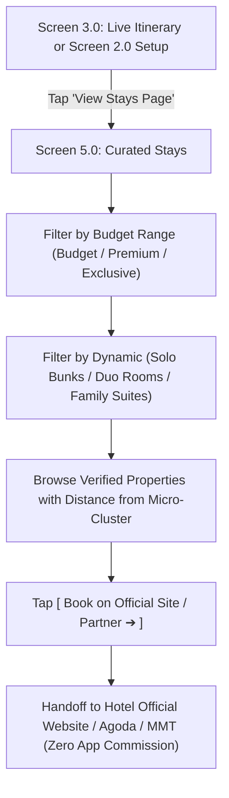
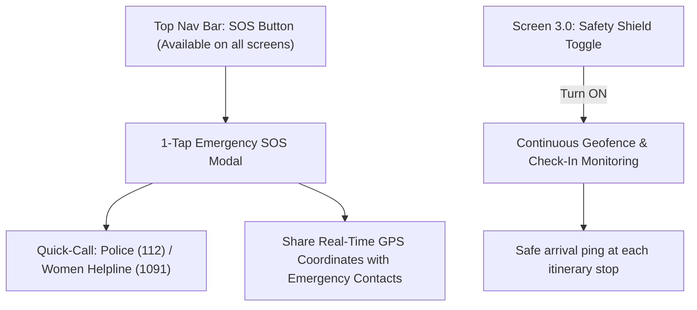

# Master Low-Fidelity Wireframes & User Flows (Phase 4)

**Project:** Hyderabad & Telangana Hyper-Local Trip Planner  
**Creative Director & Product Lead:** NIFT Hyderabad  
**Technical Project Architect:** AGY  
**Lifecycle Stage:** Phase 4 — User Flows & Low-Fidelity Structural Wireframes  
**Source Blueprints:** Hand-Drawn Dashboard/Planning Sketches + Live Itinerary Mockup + Explore Hyderabad Mockup + Dedicated Stays Specification (October 2026)

---

## 1. Architectural Scope & Nomenclature Updates

1. **Official Renaming:** The active ground execution screen is officially named **"Live Itinerary"** (replacing "Active Day Pass").
2. **Dashboard Layout:** 
   * Top bar with Profile, Search prompt, and dedicated **`SOS`** button.
   * Prominent **"Live Itinerary" tile** (displaying current active trip: *"LIVE NEXT: [Stop] • [Time]"*).
   * Hero action card: **"PLAN A NEW TRIP >"**.
   * Horizontal recommendation grid: Curated trip cards (e.g., *"Trip to Goa"*, *"Trip to Bali"*).
   * Bottom Navigation: Simple, accessible bar with `HOME` and `SAVED`.
3. **Single-Screen Planning Flow:**
   * Direct, scrollable setup: `SEARCH CITY` ➔ `DEPARTURE DATE` & `RETURN DATE` ➔ `[SOLO] [DUO] [FAMILY]` ➔ 3 Expandable Budget Cards (`Budget Friendly >`, `Premium >`, `Exclusive >`) ➔ Experience Choice (`[1st Timer]` vs `[Return Explorer]`).
4. **Live Itinerary Thread with Inline State Controls:**
   * Vertical timeline with numbered nodes, dwell times, entry fees, and live Open/Closed badge.
   * Intra-day modification tools (`Reorder`, `Skip`, `Swap Spot` with Spatial Warning alert) function as **lightweight bottom sheets and inline pop-ups directly over Screen 3.0**, requiring no separate screens.
   * Inline contextual meal break card: *"Feeling Hungry? Nearby Budget Meal Radar"*.
   * Transit pill indicator between stops (e.g., `🚶 12 min walk (900m)`).
5. **Explore Hyderabad Screen (Manual Self-Planner for Returning Explorers):**
   * Dedicated catalog screen for users who select **"Return Explorer"**.
   * Search bar with 4-D filter modal icon.
   * Horizontal scroll filter pills (`Old City Zone`, `Hitec City`, `Under ₹100`, `Dwell < 2 hrs`, `Open Today`).
   * 2-column grid of rich destination cards with bookmarking, dwell time, entry cost, and location.
   * Sticky bottom bar: **"Organise Itinerary (X places chosen) ➔ Finalise"** leading into the Live Itinerary.
6. **Dedicated "Curated Stays" Screen (New Screen 5.0):**
   * A standalone, comprehensive accommodation screen allowing travelers to browse pre-verified, clean stays filtered strictly by **Budget Range** and **Traveler Type**.
   * Features direct, one-tap booking buttons to official hotel websites or trusted partners (Agoda, MMT) without in-app payment processing.

---

## 2. Structural Wireframes (ASCII / Layout Schematics)

### WIREFRAME 1: Open Dashboard (Home Screen)

```
┌────────────────────────────────────────────────────────┐
│  ☰   [Profile / Avatar]                       ( SOS )  │
├────────────────────────────────────────────────────────┤
│                                                        │
│   WHERE WOULD YOU LIKE TO GO?                          │
│   [ Search destination...                            ] │
│                                                        │
│  ┌──────────────────────────────────────────────────┐  │
│  │  🔴 LIVE ITINERARY                               │  │
│  │  NEXT: Chowmahalla Palace • 11:30 AM             │  │
│  └──────────────────────────────────────────────────┘  │
│                                                        │
│  ┌──────────────────────────────────────────────────┐  │
│  │                                                  │  │
│  │   PLAN A NEW TRIP                            >   │  │
│  │   Build your hyper-local, budget-smart plan      │  │
│  │                                                  │  │
│  └──────────────────────────────────────────────────┘  │
│                                                        │
│   POPULAR RECOMMENDATIONS                              │
│  ┌──────────────┐  ┌──────────────┐  ┌──────────────┐  │
│  │ TRIP TO GOA  │  │ TRIP TO BALI │  │ TRIP TO...   │  │
│  │ Beaches &    │  │ Culture &    │  │ Heritage &   │  │
│  │ Sunset Trails│  │ Rice Terraces│  │ Hills        │  │
│  └──────────────┘  └──────────────┘  └──────────────┘  │
│                                                        │
├────────────────────────────────────────────────────────┤
│      [ 🏠 HOME ]                     [ 📁 SAVED ]       │
└────────────────────────────────────────────────────────┘
```

---

### WIREFRAME 2: "Plan a New Trip" Screen (Single-Page Setup)

```
┌────────────────────────────────────────────────────────┐
│  ← Back                                                │
├────────────────────────────────────────────────────────┤
│                                                        │
│  [ 🔍 SEARCH CITY (e.g. Hyderabad)                   ] │
│                                                        │
│  ┌───────────────────────┐   ┌───────────────────────┐ │
│  │ DEPARTURE DATE        │   │ RETURN DATE           │ │
│  │ [ 18 Oct 2026 ]       │   │ [ 21 Oct 2026 ]       │ │
│  └───────────────────────┘   └───────────────────────┘ │
│                                                        │
│  TRAVELLER TYPE                                        │
│  ┌──────────────┐  ┌──────────────┐  ┌──────────────┐  │
│  │  [ SOLO ]    │  │  [ DUO ]     │  │ [ FAMILY ]   │  │
│  └──────────────┘  └──────────────┘  └──────────────┘  │
│                                                        │
│  SELECT BUDGET RANGE                                   │
│  ┌──────────────────────────────────────────────────┐  │
│  │  Budget Friendly                              >  │  │
│  │  (Sub-ranges: Range 1 | Range 2 | Range 3)       │  │
│  └──────────────────────────────────────────────────┘  │
│  ┌──────────────────────────────────────────────────┐  │
│  │  Premium                                      >  │  │
│  │  (Sub-ranges: Range 1 | Range 2 | Range 3)       │  │
│  └──────────────────────────────────────────────────┘  │
│  ┌──────────────────────────────────────────────────┐  │
│  │  Exclusive                                    >  │  │
│  │  (Sub-ranges: Range 1 | Range 2 | Range 3)       │  │
│  └──────────────────────────────────────────────────┘  │
│                                                        │
│  EXPERIENCE CHOICE                                     │
│  ┌───────────────────────┐   ┌───────────────────────┐ │
│  │  1st Timer            │   │  Return Explorer      │ │
│  │  (Guided Auto-Plan)   │   │  (Manual Self-Planner)│ │
│  └───────────────────────┘   └───────────────────────┘ │
│                                                        │
│  ┌──────────────────────────────────────────────────┐  │
│  │              GENERATE ITINERARY                  │  │
│  └──────────────────────────────────────────────────┘  │
└────────────────────────────────────────────────────────┘
```

---

### WIREFRAME 3: "Live Itinerary" Screen (With Inline Intra-Day Controls)

```
┌────────────────────────────────────────────────────────┐
│  ←       Live Itinerary                    🗺️   ⋮      │
│          Old City Heritage Day                         │
├────────────────────────────────────────────────────────┤
│                                                        │
│  [ Day 1: Charminar Cluster ]   [ Day 2 ]   [ Day 3 ]  │
│                                                        │
│  ┌───────────────────────┬──────────────────────────┐  │
│  │ 🏨 View Stays Page    │ 📥 Offline Pass Saved    │  │
│  │ (Budget Match)        │ 🛡️ Safety Shield [ON]    │  │
│  └───────────────────────┴──────────────────────────┘  │
│                                                        │
│   :                                                    │
│  (1)── ┌────────────────────────────────────────────┐  │
│   │    │ [Photo]  Charminar & Laad Bazaar        🔖 │  │
│   │    │          Heritage • Shopping • Culture     │  │
│   │    │                                            │  │
│   │    │  ⏱️ Dwell: 1.5 hrs        🎟️ ₹25 Entry      │  │
│   │    │  🟢 Open Now • Closes 5:30 PM              │  │
│   │    ├────────────────────────────────────────────┤  │
│   │    │ [ ⇅ Reorder ]   [ ⇄ Swap Spot ]   [ ✕ Skip]│  │
│   │    └────────────────────────────────────────────┘  │
│   :                                                    │
│  ┌──────────────────────────────────────────────────┐  │
│  │ 🍽️  Feeling Hungry?                              │  │
│  │     Nearby Budget Meal Radar (Within 350m)       │  │
│  │                                                  │  │
│  │   ┌────────────────────┐   ┌─────────────────┐   │  │
│  │   │ Cafe 555           │   │ Shadab Biryani  │ > │  │
│  │   │ Irani Chai         │   │ Non-Veg         │   │  │
│  │   │ ₹50 - ₹120         │   │ ₹150 - ₹300     │   │  │
│  │   └────────────────────┘   └─────────────────┘   │  │
│  └──────────────────────────────────────────────────┘  │
│   :                                                    │
│  (2)── ┌────────────────────────────────────────────┐  │
│   │    │ [Photo]  Chowmahalla Palace             🔖 │  │
│   │    │          Royal • Architecture • History    │  │
│   │    │                                            │  │
│   │    │  [ 🚶 12 min walk (900m) ]                 │  │
│   │    │  ⏱️ Dwell: 2.0 hrs        🎟️ ₹100 Entry     │  │
│   │    │  🟢 Open Now • Closes 5:00 PM              │  │
│   │    ├────────────────────────────────────────────┤  │
│   │    │ [ ⇅ Reorder ]   [ ⇄ Swap Spot ]   [ ✕ Skip]│  │
│   │    └────────────────────────────────────────────┘  │
│   :                                                    │
└────────────────────────────────────────────────────────┘

[INLINE STATE OVERLAYS OVER SCREEN 3.0]:
• Tapping [⇄ Swap Spot] ➔ Bottom Sheet slides up with Same-Cluster Recommendations.
• Selecting Distant Spot ➔ Overlay alert: "⚠️ Spatial Advisory: Golconda is 14 km away (~45m transit). Proceed?"
• Tapping [✕ Skip] ➔ Removes stop and smoothly reconnects timeline to next stop.
```

---

### WIREFRAME 4: "Explore Hyderabad" Screen (Return Explorer — Manual Self-Planner)

```
┌────────────────────────────────────────────────────────┐
│  Explore Hyderabad                                     │
│  Discover more. Plan better.                           │
├────────────────────────────────────────────────────────┤
│                                                        │
│  [ 🔍 Search monuments, cafes, gardens...         🎛️ ] │
│                                                        │
│  FILTER PILLS ROW (Horizontal Scroll):                 │
│  [● Old City Zone] [Hitec City] [Under ₹100] [Dwell<2h]│
│                                                        │
│  PLACES GRID (2-Column Layout):                        │
│  ┌────────────────────────┐  ┌───────────────────────┐ │
│  │ [Image]        [🔖]   │  │ [Image]        [🔖]  │ │
│  │ 🟢 Open Now            │  │ 🟢 Open Now           │ │
│  │ Qutb Shahi Tombs       │  │ Golconda Fort         │ │
│  │ Heritage • History     │  │ Heritage • History    │ │
│  │ 🎟️ ₹25    🚶 18m walk  │  │ 🎟️ ₹75   🚗 20m drive │ │
│  │ [Dwell: 1.5h] [ToliCh.]│  │ [Dwell: 2h]  [Golcon.]│ │
│  │ ⭐ 4.4 (2.8k)          │  │ ⭐ 4.6 (4.2k)         │ │
│  │ [ + Add to My Plan ]   │  │ [ + Add to My Plan ]  │ │
│  └────────────────────────┘  └───────────────────────┘ │
│  ┌────────────────────────┐  ┌───────────────────────┐ │
│  │ [Image]        [🔖]   │  │ [Image]        [🔖]  │ │
│  │ 🟢 Open Now            │  │ 🟢 Open Now           │ │
│  │ Salar Jung Museum      │  │ Mecca Masjid          │ │
│  │ Museum • Art • Culture │  │ Heritage • Faith      │ │
│  │ 🎟️ ₹60    🚗 12m drive │  │ 🎟️ ₹10    🚶 15m walk │ │
│  │ [Dwell: 2h]  [Daruss.] │  │ [Dwell: 1h]  [OldCity]│ │
│  │ ⭐ 4.5 (3.1k)          │  │ ⭐ 4.3 (1.9k)         │ │
│  │ [ + Add to My Plan ]   │  │ [ + Add to My Plan ]  │ │
│  └────────────────────────┘  └───────────────────────┘ │
│                                                        │
├────────────────────────────────────────────────────────┤
│  [ 🧭 ORGANISE ITINERARY (4 Selected) ➔ FINALISED ]    │
└────────────────────────────────────────────────────────┘
```

---

### WIREFRAME 5: Dedicated "Curated Stays" Screen (Accommodations Finder)

```
┌────────────────────────────────────────────────────────┐
│  ← Back    Curated Stays in Hyderabad             🔍   │
│            Pre-verified, clean & budget-matched        │
├────────────────────────────────────────────────────────┤
│                                                        │
│  FILTER BY BUDGET TIER:                                │
│  [● Budget-Friendly]   [Premium]   [Exclusive Luxury]  │
│                                                        │
│  FILTER BY TRAVELER TYPE:                              │
│  [● Solo (Hostels/Bunks)]  [Duo (Rooms)]  [Family (Suites)]│
│                                                        │
│  STAYS FEED:                                           │
│  ┌──────────────────────────────────────────────────┐  │
│  │ [Photo: Interior / Clean Room]               🔖  │  │
│  │                                                  │  │
│  │ Zostel Hyderabad (Abids / Old City Hub)          │  │
│  │ ⭐ 4.6 (1.2k Reviews) • 2.2 km from Charminar    │  │
│  │                                                  │  │
│  │ 🏷️ Backpacker Bunk • Female/Mixed Dorms          │  │
│  │ ✨ Fast Wi-Fi • Clean Sanitized Washrooms • AC   │  │
│  │                                                  │  │
│  │ 💰 ₹799 / night                                  │  │
│  │ [ Book on Official Site / Agoda ➔ ]              │  │
│  └──────────────────────────────────────────────────┘  │
│                                                        │
│  ┌──────────────────────────────────────────────────┐  │
│  │ [Photo: Heritage Courtyard Guesthouse]       🔖  │  │
│  │                                                  │  │
│  │ Heritage Haveli Guesthouse (Lakdikapul)          │  │
│  │ ⭐ 4.5 (890 Reviews) • Central Transit Hub       │  │
│  │                                                  │  │
│  │ 🏷️ Private Deluxe Room • 24/7 Security           │  │
│  │ ✨ Spacious Restrooms • Quiet Ambience • Metro   │  │
│  │                                                  │  │
│  │ 💰 ₹1,450 / night                                │  │
│  │ [ Book on Official Site / MMT ➔ ]                │  │
│  └──────────────────────────────────────────────────┘  │
│                                                        │
│  ┌──────────────────────────────────────────────────┐  │
│  │ [Photo: Boutique Business Hotel]             🔖  │  │
│  │                                                  │  │
│  │ The Park Banjara (Banjara Hills / Jubilee Hub)   │  │
│  │ ⭐ 4.7 (2.4k Reviews) • Boutique Luxury          │  │
│  │                                                  │  │
│  │ 🏷️ Premium City View Room • Rooftop Pool         │  │
│  │ ✨ Express Check-in • Concierge • Luxury Linen   │  │
│  │                                                  │  │
│  │ 💰 ₹4,200 / night                                │  │
│  │ [ Book on Official Site / Agoda ➔ ]              │  │
│  └──────────────────────────────────────────────────┘  │
│                                                        │
└────────────────────────────────────────────────────────┘
```

---

## 3. User Task Flows (End-to-End Decision & Navigation Logic)

### Flow 1: 1st-Timer Guided Planning Flow


---

### Flow 2: Returning Explorer Manual Self-Planner Flow


---

### Flow 3: In-Trip Real-Time Execution & Intra-Day Modification


---

### Flow 4: Dedicated Stays Discovery & Direct Booking Flow


---

### Flow 5: Opt-In Safety Shield & Emergency SOS

