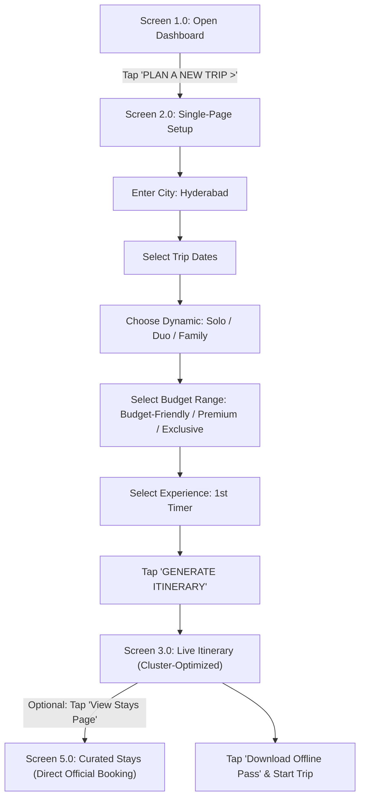
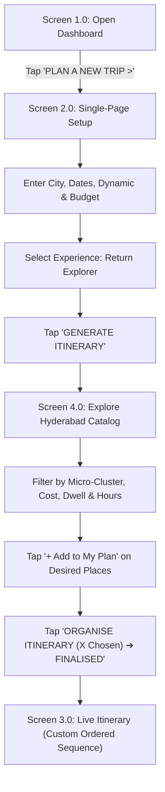
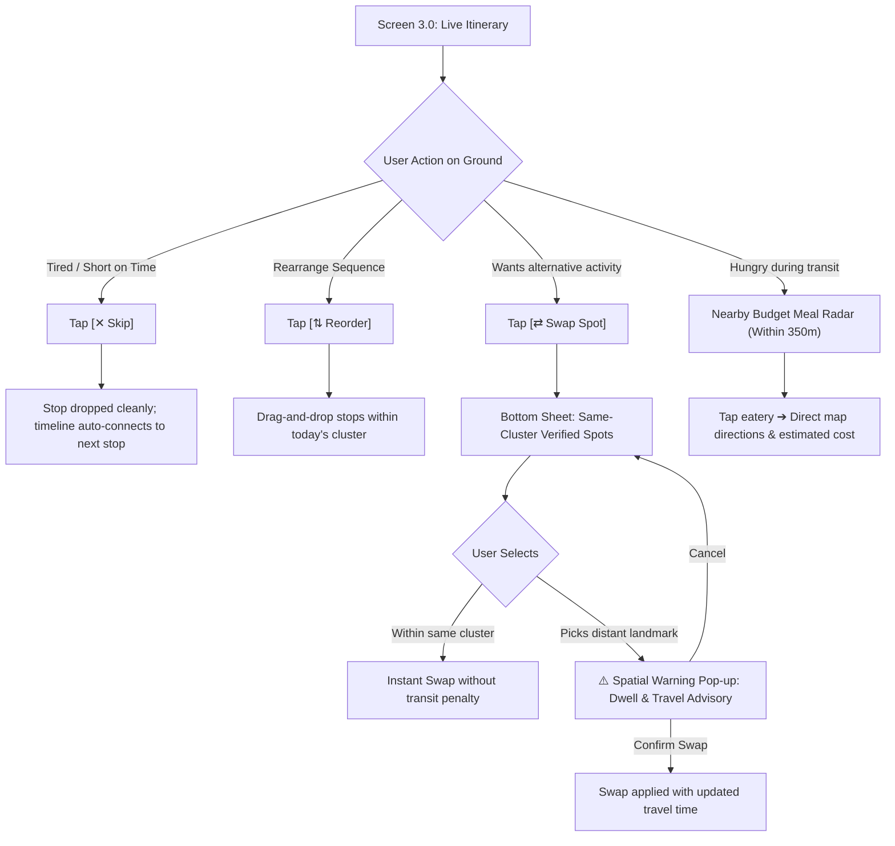
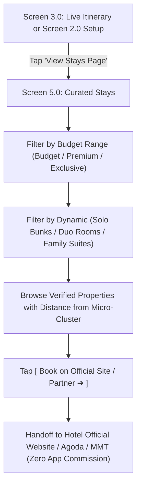
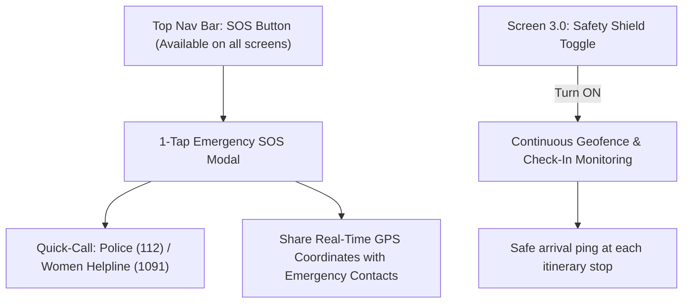

# Master Low-Fidelity Wireframes & User Flows (Phase 4)

**Project:** Hyderabad & Telangana Hyper-Local Trip Planner  
**Creative Director & Product Lead:** NIFT Hyderabad  
**Technical Project Architect:** AGY  
**Lifecycle Stage:** Phase 4 — User Flows & Low-Fidelity Structural Wireframes  
**Source Blueprints:** Hand-Drawn Dashboard/Planning Sketches + Live Itinerary Mockup + Explore Hyderabad Mockup + Dedicated Stays Specification (October 2026)

---

## 1. Architectural Scope & Nomenclature Updates

1. **Official Renaming:** The active ground execution screen is officially named **"Live Itinerary"** (replacing "Active Day Pass").
2. **Dashboard Layout:** 
   * Top bar with Profile, Search prompt, and dedicated **`SOS`** button.
   * Prominent **"Live Itinerary" tile** (displaying current active trip: *"LIVE NEXT: [Stop] • [Time]"*).
   * Hero action card: **"PLAN A NEW TRIP >"**.
   * Horizontal recommendation grid: Curated trip cards (e.g., *"Trip to Goa"*, *"Trip to Bali"*).
   * Bottom Navigation: Simple, accessible bar with `HOME` and `SAVED`.
3. **Single-Screen Scrollable Planning Setup (Creative Steering Question 2 Resolution):**
   * Completely consolidated into a fluid **Single-Screen Scrollable Setup** (no fragmented multi-screen wizard pagination).
   * Direct vertical scroll flow: Top Destination Slideshow ➔ `[1st Sec] YOUR DESTINATION` (with predictive autocomplete dropdown) ➔ `[2nd Sec] TRIP DATES` (Arrival & Return with calendar pickers) ➔ `[3rd Sec] TRAVEL DYNAMIC` (`[Solo]` `[Duo]` `[Family]`) ➔ `[4th Sec] BUDGET RANGE` (3 expandable accordion tiers with identical sub-range naming) ➔ `[5th Sec] EXPERIENCE CHOICE` (`[1st Timer]` vs `[Experience Explorer]`) ➔ Sticky Terracotta CTA `GENERATE ITINERARY ➔`.
4. **"Your Itinerary" Screen Architecture (Creative Steering Question 3 Resolution & Reference `media_1795249816175.png`):**
   * Top navigation bar with Back Arrow (`←`), `Your Itinerary` serif title, map icon (`🗺️`), red SOS pill (`[ 🛡️ SOS ]`), and circular profile avatar.
   * Heritage watercolor hero backdrop featuring Charminar and cursive script: *"Your trip, well planned ✨"* with warm brush stroke.
   * Floating segmented day switcher: `[ 📍 Day 1: Old City (Active) ]`, `[ Day 2: Western Forts ]`, `[ Day 3: Cyberabad ]`.
   * Continuous vertical terracotta timeline rail running down the left connecting numbered circle nodes (`1`, `2`) and a midpoint dot.
   * Stop Cards with thumbnail, title, entry badge (`🎫 ₹25 Entry`), dwell badge (`🕒 Dwell: 1.5 hrs`), live status (`🟢 Open Now • Closes 5:30 PM`), and 3 bottom pill buttons (`[ ⇅ Reorder ]`, `[ ⇄ Swap ]`, `[ ✕ Skip Stop ]`).
   * Contextual peach meal break card: *"Feeling Hungry? (Within 500m)"* with `View Options ›` and 2 horizontal mini cards (`Nimrah Cafe`, `Shadab`).
   * Floating "Next Stop" banner above bottom nav (`Next Stop Golconda Fort • 📍 ~ 20 min away ›`).
5. **Explore Hyderabad Screen (Manual Self-Planner for Returning Explorers):**
   * Dedicated catalog screen for users who select **"Return Explorer"**.
   * Search bar with 4-D filter modal icon.
   * Horizontal scroll filter pills (`Old City Zone`, `Hitec City`, `Under ₹100`, `Dwell < 2 hrs`, `Open Today`).
   * 2-column grid of rich destination cards with bookmarking, dwell time, entry cost, and location.
   * Sticky bottom bar: **"Organise Itinerary (X places chosen) ➔ Finalise"** leading into the Live Itinerary.
6. **Dedicated "Curated Stays" Screen (New Screen 5.0):**
   * A standalone, comprehensive accommodation screen allowing travelers to browse pre-verified, clean stays filtered strictly by **Budget Range** and **Traveler Type**.
   * Features direct, one-tap booking buttons to official hotel websites or trusted partners (Agoda, MMT) without in-app payment processing.

---

## 2. Structural Wireframes (ASCII / Layout Schematics)

### WIREFRAME 1A: Open Dashboard — State A (For Users WITHOUT an Active/Ongoing Trip)
*Default landing hub for new visitors or users between trips. Directly integrates the 6-section planning flow and top recommendation slideshow.*

```
┌────────────────────────────────────────────────────────┐
│  📍 Hyderabad, Telangana ∨             [+ SOS]   (👤)  │
├────────────────────────────────────────────────────────┤
│                                                        │
│   Plan a New Trip                                      │
│   Let's explore more ✨                                │
│                                                        │
│  ┌──────────────────────────────────────────────────┐  │
│  │ 🖼️ [RECOMMENDED DESTINATIONS SLIDESHOW CAROUSEL]  │  │
│  │ « Trip to Goa  •  Trip to Bali  •  Trip to Hampi »│  │
│  └──────────────────────────────────────────────────┘  │
│                                                        │
│  SECTION 1: YOUR DESTINATION                           │
│  ┌──────────────────────────────────────────────────┐  │
│  │ 🔍 Where do you want to go?                   ✈️ │  │
│  └──────────────────────────────────────────────────┘  │
│    └─► [AUTOCOMPLETE DROPDOWN: "H" ➔ Hyderabad,        │
│                                      Himachal Pradesh] │
│                                                        │
│  SECTION 2: TRIP DATES                                 │
│  ┌───────────────────────┐   ┌───────────────────────┐ │
│  │ 📅 Arrival Date     > │   │ 📅 Return Date      > │ │
│  └───────────────────────┘   └───────────────────────┘ │
│                                                        │
│  SECTION 3: TRAVEL DYNAMIC                             │
│  ┌──────────────┐  ┌──────────────┐  ┌──────────────┐  │
│  │   👤 Solo    │  │   👥 Duo     │  │  👨‍👩‍👧‍👦 Family   │  │
│  └──────────────┘  └──────────────┘  └──────────────┘  │
│                                                        │
│  SECTION 4: BUDGET RANGE (3 Tiers with 3 Sub-Ranges)   │
│  ┌──────────────────────────────────────────────────┐  │
│  │ 👛 Budget Friendly                               > │  │
│  │   • Baseline Saver   • Mid Comfort   • Plus Day  │  │
│  └──────────────────────────────────────────────────┘  │
│  ┌──────────────────────────────────────────────────┐  │
│  │ 👑 Premium                                       > │  │
│  │   • Baseline Saver   • Mid Comfort   • Plus Day  │  │
│  └──────────────────────────────────────────────────┘  │
│  ┌──────────────────────────────────────────────────┐  │
│  │ 💎 Luxury / Exclusive                            > │  │
│  │   • Baseline Saver   • Mid Comfort   • Plus Day  │  │
│  └──────────────────────────────────────────────────┘  │
│                                                        │
│  SECTION 5: EXPERIENCE CHOICE                          │
│  ┌───────────────────────┐   ┌───────────────────────┐ │
│  │     [🎒 Backpack]     │   │    [🔭 Binoculars]    │ │
│  │ 1st Timer         (○) │   │ Experience Explorer(○)│ │
│  │ A perfect start to    │   │ Discover more, go     │ │
│  │ your journey!         │   │ deeper!               │ │
│  └───────────────────────┘   └───────────────────────┘ │
│                                                        │
│  ┌──────────────────────────────────────────────────┐  │
│  │           ✈️ GENERATE ITINERARY ➔                 │  │
│  └──────────────────────────────────────────────────┘  │
│                                                        │
├────────────────────────────────────────────────────────┤
│  [🏠 Home]    [🗺️ Itinerary]    [🧭 Explore]   [🔖 Saved]│
└────────────────────────────────────────────────────────┘
```

---

### WIREFRAME 1B: Open Dashboard — State B (For Users WITH an Active/Ongoing Trip)
*Contextual dynamic landing screen for travelers currently on the road. Tapping "Build a New Trip" opens Wireframe 1A.*

```
┌────────────────────────────────────────────────────────┐
│  📍 Hyderabad, Telangana ∨             [+ SOS]   (👤)  │
├────────────────────────────────────────────────────────┤
│                                                        │
│   Where would you like to explore today?               │
│                                                        │
│  ┌──────────────────────────────────────────────────┐  │
│  │ [Active Trip Pass Pill]                          │  │
│  │ Old City Heritage Day            [Charminar      │  │
│  │ Next: Chowmahalla Palace • 11:30 AM  Photo]      │  │
│  └──────────────────────────────────────────────────┘  │
│                                                        │
│  ┌──────────────────────────────────────────────────┐  │
│  │ 📖 Build a New Trip (1–3 Days)                 > │  │
│  │    Choose your budget, interests & we'll curate  │  │
│  │    [Easy ₹1.7k]    [Premium ₹5k]    [Luxury ₹25k]│  │
│  │    *(Tapping this card opens Wireframe 1A directly)│  │
│  └──────────────────────────────────────────────────┘  │
│                                                        │
│  ┌──────────────────────────────────────────────────┐  │
│  │ 📍 Explore 45 Curated Spots                    > │  │
│  │    Monuments, food, culture, nature & more       │  │
│  └──────────────────────────────────────────────────┘  │
│                                                        │
├────────────────────────────────────────────────────────┤
│  [🏠 Home]    [🗺️ Itinerary]    [🧭 Explore]   [🔖 Saved]│
└────────────────────────────────────────────────────────┘
```

---

### WIREFRAME 3: "Your Itinerary" Screen (Direct Reference `media_1795249816175.png`)
*Step-by-step active navigation screen with watercolor heritage hero banner, segmented day switcher pills, vertical terracotta timeline rail, inline food radar, and floating next stop banner.*

```
┌────────────────────────────────────────────────────────┐
│  ←  Your Itinerary                     [🗺️] [🛡️ SOS] (👤)│
├────────────────────────────────────────────────────────┤
│  [HERO WATERCOLOR BACKDROP: CHARMINAR & HERITAGE DOMES]│
│                                                        │
│  "Your trip,                                           │
│   well planned ✨"                                     │
│   ───────────────── (warm brush stroke)                │
│                                                        │
│  ┌──────────────────────────────────────────────────┐  │
│  │ [📍 Day 1: Old City (Active)] [Day 2] [Day 3]    │  │
│  └──────────────────────────────────────────────────┘  │
│                                                        │
│  │ (Vertical Terracotta Timeline Rail)                 │
│ (1)── ┌─────────────────────────────────────────────┐  │
│  │    │ [Thumb]  Charminar & Laad Bazaar            │  │
│  │    │          [🎫 ₹25 Entry]  [🕒 Dwell: 1.5 hrs] │  │
│  │    │          [🟢 Open Now • Closes 5:30 PM]     │  │
│  │    ├─────────────────────────────────────────────┤  │
│  │    │  [ ⇅ Reorder ]   [ ⇄ Swap ]   [ ✕ Skip Stop]│  │
│  │    └─────────────────────────────────────────────┘  │
│  │                                                     │
│ (•)── ┌─────────────────────────────────────────────┐  │
│  │    │ 🍴 Feeling Hungry? (Within 500m)   View >   │  │
│  │    │ ┌───────────────────┐  ┌──────────────────┐ │  │
│  │    │ │ [☕] Nimrah Cafe  │  │ [🍲] Shadab      │ │  │
│  │    │ │     ₹50 - ₹100    │  │     ₹100 - ₹200  │ │  │
│  │    │ └───────────────────┘  └──────────────────┘ │  │
│  │    └─────────────────────────────────────────────┘  │
│  │                                                     │
│ (2)── ┌─────────────────────────────────────────────┐  │
│  │    │ [Thumb]  Chowmahalla Palace                 │  │
│  │    │          [🎫 ₹100 Entry] [🕒 Dwell: 2 hrs]   │  │
│  │    │          [🟢 Open Now]                      │  │
│  │    ├─────────────────────────────────────────────┤  │
│  │    │  [ ⇅ Reorder ]   [ ⇄ Swap ]   [ ✕ Skip Stop]│  │
│  │    └─────────────────────────────────────────────┘  │
│  │                                                     │
│  ┌──────────────────────────────────────────────────┐  │
│  │ [🏰 Thumb] Next Stop: Golconda Fort [📍 ~20m >]  │  │
│  └──────────────────────────────────────────────────┘  │
│                                                        │
├────────────────────────────────────────────────────────┤
│  [🏠 Home]    [📅 Itinerary]    [🔍 Explore]   [🔖 Saved]│
└────────────────────────────────────────────────────────┘
```

[INLINE STATE OVERLAYS OVER SCREEN 3]:
• Tapping `[⇄ Swap]` ➔ Bottom Sheet slides up with Same-Cluster Recommendations.
• Selecting Distant Spot ➔ Overlay alert: *"⚠️ Spatial Advisory: Golconda is 14 km away (~45m transit). Proceed?"*
• Tapping `[✕ Skip Stop]` ➔ Removes stop and smoothly reconnects timeline to next stop.
• Tapping `[ 🍴 View Options ]` ➔ Expands nearby food radar places within 500m walking radius.


---

### WIREFRAME 4: "Explore Hyderabad" Screen (Return Explorer — Manual Self-Planner)

```
┌────────────────────────────────────────────────────────┐
│  Explore Hyderabad                                     │
│  Discover more. Plan better.                           │
├────────────────────────────────────────────────────────┤
│                                                        │
│  [ 🔍 Search monuments, cafes, gardens...         🎛️ ] │
│                                                        │
│  FILTER PILLS ROW (Horizontal Scroll):                 │
│  [● Old City Zone] [Hitec City] [Under ₹100] [Dwell<2h]│
│                                                        │
│  PLACES GRID (2-Column Layout):                        │
│  ┌────────────────────────┐  ┌───────────────────────┐ │
│  │ [Image]        [🔖]   │  │ [Image]        [🔖]  │ │
│  │ 🟢 Open Now            │  │ 🟢 Open Now           │ │
│  │ Qutb Shahi Tombs       │  │ Golconda Fort         │ │
│  │ Heritage • History     │  │ Heritage • History    │ │
│  │ 🎟️ ₹25    🚶 18m walk  │  │ 🎟️ ₹75   🚗 20m drive │ │
│  │ [Dwell: 1.5h] [ToliCh.]│  │ [Dwell: 2h]  [Golcon.]│ │
│  │ ⭐ 4.4 (2.8k)          │  │ ⭐ 4.6 (4.2k)         │ │
│  │ [ + Add to My Plan ]   │  │ [ + Add to My Plan ]  │ │
│  └────────────────────────┘  └───────────────────────┘ │
│  ┌────────────────────────┐  ┌───────────────────────┐ │
│  │ [Image]        [🔖]   │  │ [Image]        [🔖]  │ │
│  │ 🟢 Open Now            │  │ 🟢 Open Now           │ │
│  │ Salar Jung Museum      │  │ Mecca Masjid          │ │
│  │ Museum • Art • Culture │  │ Heritage • Faith      │ │
│  │ 🎟️ ₹60    🚗 12m drive │  │ 🎟️ ₹10    🚶 15m walk │ │
│  │ [Dwell: 2h]  [Daruss.] │  │ [Dwell: 1h]  [OldCity]│ │
│  │ ⭐ 4.5 (3.1k)          │  │ ⭐ 4.3 (1.9k)         │ │
│  │ [ + Add to My Plan ]   │  │ [ + Add to My Plan ]  │ │
│  └────────────────────────┘  └───────────────────────┘ │
│                                                        │
├────────────────────────────────────────────────────────┤
│  [ 🧭 ORGANISE ITINERARY (4 Selected) ➔ FINALISED ]    │
└────────────────────────────────────────────────────────┘
```

---

### WIREFRAME 5: Dedicated "Curated Stays" Screen (Accommodations Finder)

```
┌────────────────────────────────────────────────────────┐
│  ← Back    Curated Stays in Hyderabad             🔍   │
│            Pre-verified, clean & budget-matched        │
├────────────────────────────────────────────────────────┤
│                                                        │
│  FILTER BY BUDGET TIER:                                │
│  [● Budget-Friendly]   [Premium]   [Exclusive Luxury]  │
│                                                        │
│  FILTER BY TRAVELER TYPE:                              │
│  [● Solo (Hostels/Bunks)]  [Duo (Rooms)]  [Family (Suites)]│
│                                                        │
│  STAYS FEED:                                           │
│  ┌──────────────────────────────────────────────────┐  │
│  │ [Photo: Interior / Clean Room]               🔖  │  │
│  │                                                  │  │
│  │ Zostel Hyderabad (Abids / Old City Hub)          │  │
│  │ ⭐ 4.6 (1.2k Reviews) • 2.2 km from Charminar    │  │
│  │                                                  │  │
│  │ 🏷️ Backpacker Bunk • Female/Mixed Dorms          │  │
│  │ ✨ Fast Wi-Fi • Clean Sanitized Washrooms • AC   │  │
│  │                                                  │  │
│  │ 💰 ₹799 / night                                  │  │
│  │ [ Book on Official Site / Agoda ➔ ]              │  │
│  └──────────────────────────────────────────────────┘  │
│                                                        │
│  ┌──────────────────────────────────────────────────┐  │
│  │ [Photo: Heritage Courtyard Guesthouse]       🔖  │  │
│  │                                                  │  │
│  │ Heritage Haveli Guesthouse (Lakdikapul)          │  │
│  │ ⭐ 4.5 (890 Reviews) • Central Transit Hub       │  │
│  │                                                  │  │
│  │ 🏷️ Private Deluxe Room • 24/7 Security           │  │
│  │ ✨ Spacious Restrooms • Quiet Ambience • Metro   │  │
│  │                                                  │  │
│  │ 💰 ₹1,450 / night                                │  │
│  │ [ Book on Official Site / MMT ➔ ]                │  │
│  └──────────────────────────────────────────────────┘  │
│                                                        │
│  ┌──────────────────────────────────────────────────┐  │
│  │ [Photo: Boutique Business Hotel]             🔖  │  │
│  │                                                  │  │
│  │ The Park Banjara (Banjara Hills / Jubilee Hub)   │  │
│  │ ⭐ 4.7 (2.4k Reviews) • Boutique Luxury          │  │
│  │                                                  │  │
│  │ 🏷️ Premium City View Room • Rooftop Pool         │  │
│  │ ✨ Express Check-in • Concierge • Luxury Linen   │  │
│  │                                                  │  │
│  │ 💰 ₹4,200 / night                                │  │
│  │ [ Book on Official Site / Agoda ➔ ]              │  │
│  └──────────────────────────────────────────────────┘  │
│                                                        │
└────────────────────────────────────────────────────────┘
```

---

## 3. User Task Flows (End-to-End Decision & Navigation Logic)

### Flow 1: 1st-Timer Guided Planning Flow


---

### Flow 2: Returning Explorer Manual Self-Planner Flow


---

### Flow 3: In-Trip Real-Time Execution & Intra-Day Modification


---

### Flow 4: Dedicated Stays Discovery & Direct Booking Flow


---

### Flow 5: Opt-In Safety Shield & Emergency SOS

