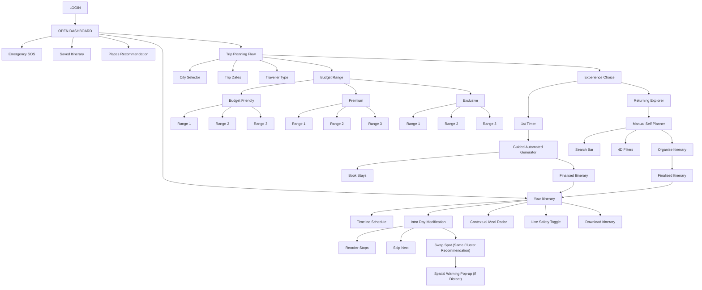

# Phase 3: Master Summary & Outputs Reference Document

**Project Title:** Hyderabad & Telangana Hyper-Local, Budget-Intelligent Trip Planner  
**Creative Director & Product Lead:** NIFT Hyderabad  
**Technical Project Architect:** AGY  
**Lifecycle Stage:** Phase 3 — Information Architecture & Taxonomy (Master Outputs)  
**Document Purpose:** Central master reference for all datasets, 4-dimensional filter matrices, feature card sorting decks, and the official hand-drawn sitemap tree established during Phase 3.

---

## 1. Executive Summary & Phase 3 Milestone Achievements

In Phase 3, the product transitioned from abstract user personas into a concrete, mathematically structured **Information Architecture (IA)**. 

### Key Accomplishments:
1. **Verified Real-World Content Inventory:** Curated and fact-checked 45 destinations across Hyderabad and regional Telangana.
2. **Dynamic Dining Architecture:** Decoupled static restaurant listings in favor of a live, real-time proximity API (Google Places / OpenStreetMap) that surfaces open, budget-matched meals within walking distance.
3. **4-Dimensional Classification Engine:** Grouped destinations across Proximity, Operating Hours/Closed Days, Pricing Tiers, and Dwell Times.
4. **Card Sorting Feature Deck:** Synthesized 23 discrete user feature cards with plain-language definitions and user values.
5. **Visual Sitemap Tree Lock-In:** Formally codified the Creative Director's hand-drawn master sitemap tree into digital architecture.

---

## 2. Content Inventory Summary (45 Destination Cards)

All 45 places contain strictly objective, verified attributes (Location, Operating Hours, Ticket Prices, Dwell Times, and Activity Type) documented in [HYDERABAD_PLACES_DATASET.md](file:///c:/Users/ANKITA/Documents/Ankita_BD-24-618/HYDERABAD_PLACES_DATASET.md):

* **Heritage & Royal Palaces (8):** Charminar, Golconda Fort, Qutb Shahi Tombs, Chowmahalla Palace, Salar Jung Museum, Paigah Tombs, British Residency (Koti), Taj Falaknuma Palace.
* **Spiritual & Sacred Landmarks (5):** Mecca Masjid, Birla Mandir, Rasoolpura Sri Ujjaini Mahakali Temple, Statue of Equality (Muchintal), Ammapalle Stepwell & Sita Ramachandra Temple.
* **Nature, Lakes & Scenic Parks (10):** KBR National Park, Durgam Cheruvu & Cable Bridge, Hussain Sagar & Buddha Statue, Lakefront Park (PVNR Marg), Nehru Zoological Park, Maula Ali Dargah Hill, Khajaguda Hills & Boulders, Gandipet Landscape & Eco Park, Himayat Sagar Dam, Ficus Garden (Botanical Garden).
* **Pedestrian & Cultural Enclaves (4):** Raidurg Skywalk, Shilparamam Arts & Crafts Village, State Gallery of Art, Laad Bazaar.
* **Entertainment & Major Malls (5):** Prasad's Multiplex & Experium, Inorbit Mall Cyberabad, Sarath City Capital Mall, Nexus Hyderabad Mall, Suncity Mall.
* **Adventure & Outdoor Parks (2):** Narsapur Forest Urban Park, Cliffin Adventures.
* **Regional Outskirts & Extended Day Trips (11):** Ramoji Film City, Bhongir Fort (Monolith), Rachakonda Fort, Ananthagiri Hills & Vikarabad Forest, Kotepally Reservoir, Pocharam Wildlife Sanctuary & Dam, Medak Cathedral & Fort, Nagarjuna Sagar Dam, Srisailam, Belum Caves, Chirala Beach & Handlooms.

---

## 3. The 4-Dimensional Information Architecture Matrices

To guarantee smart, realistic, and stress-free itinerary assembly, all 45 places are organized across 4 operational dimensions in [HYDERABAD_ITINERARY_FILTERS.md](file:///c:/Users/ANKITA/Documents/Ankita_BD-24-618/HYDERABAD_ITINERARY_FILTERS.md):

### Dimension 1: Spatial Proximity (13 Geographic Single-Day Clusters)
1. Old City Heritage Core (Walkable 1.5 km)
2. Western Fort & Royal Tombs (Golconda / Qutb Shahi)
3. Central Lake & Tank Bund Promenade
4. Jubilee Hills Green Belt
5. Hitec City & Cyberabad Corridor
6. Gachibowli & Kondapur Boulders / Retail
7. South-West Lakes, Reserves & Shamshabad
8. Southern Heritage Outskirts (Falaknuma / Paigah)
9. Secunderabad & Northern Transit Hub
10. Eastern Outskirts & Adventure (Warangal Highway)
11. Western Nature & Kayaking (Vikarabad Circuit)
12. Northern Heritage & Sanctuary (Medak Circuit)
13. Extended Regional Excursions (Nagarjuna Sagar, Srisailam, Belum, Chirala)

### Dimension 2: Operating Hours & Closed-Day Safeguards
* **Early Morning Starters (04:00 AM – 06:00 AM):** Mecca Masjid, KBR Park, Lakefront Park, Ficus Garden, Maula Ali Hill, Khajaguda Hills, Himayat Sagar, Ammapalle Stepwell, Chirala Beach.
* **Standard Daytime Culture (09:00 AM – 05:00 / 05:30 PM):** Charminar, Golconda, Qutb Shahi Tombs, Chowmahalla, Salar Jung, Paigah Tombs, Nehru Zoo, Shilparamam, Narsapur Forest, Bhongir Fort, Belum Caves.
* **Afternoon & Night Hubs (till 10:00 PM – 11:30 PM):** Durgam Cheruvu Cable Bridge, Hussain Sagar, Prasad's Experium, Malls, Laad Bazaar, Statue of Equality laser show.
* **Split-Shift Slots:** Birla Mandir (7–12 PM & 3–9 PM), Rasoolpura Temple (6–12 PM & 5–9 PM), KBR Park (5:30–10 AM & 4–7 PM).
* **CRITICAL CLOSED DAYS:**
  * **Fridays:** Chowmahalla Palace, Salar Jung Museum, Nagarjuna Sagar Island Museum *(Mecca Masjid tourist restriction 12:30–2:30 PM)*.
  * **Mondays:** Nehru Zoological Park.
  * **Wednesdays:** Statue of Equality.

### Dimension 3: Price & Budget Segregation
* **Tier 1: 100% Free Public Entry (₹0 — 21 Destinations):** Public parks, open temples/mosques, lakes, hills, stepwells, malls, and outdoor fort ruins.
* **Tier 2: Micro-Budget Government Tariffs (≤ ₹50 — 11 Destinations):** Charminar, Golconda, Qutb Shahi Tombs, Salar Jung (₹50 / ₹20 student), KBR Park, Gandipet Park, Bhongir Fort.
* **Tier 3: Mid-Tier Ticketed Activities (₹51 – ₹200 — 7 Destinations):** Chowmahalla (₹100), Nehru Zoo (₹70–₹80), Shilparamam (₹60), Statue of Equality (₹200), Belum Caves (₹70), Boats to Buddha & Island.
* **Tier 4: Premium & Commercial Excursions (₹300 – ₹5,000+ — 6 Destinations):** Cliffin Adventures, Prasad's Experium, Ramoji Film City (₹1,350), Taj Falaknuma Palace tour/dining (₹3,100 – ₹5,500+).

### Dimension 4: Dwell Time & Pacing Allocation
* **Quick / Micro-Stops (30 – 60 Mins — 10 Places):** Charminar, Paigah Tombs, British Residency, Mecca Masjid, Himayat Sagar, Skywalk, Rasoolpura Temple, State Gallery of Art.
* **Medium Dwell Anchors (1.5 – 2 Hours — 12 Places):** Qutb Shahi Tombs, Chowmahalla, Birla Mandir, KBR Park, Durgam Cheruvu, Hussain Sagar, Lakefront Park, Maula Ali, Khajaguda Hills, Gandipet Park.
* **Half-Day Deep Anchors (2.5 – 4 Hours — 18 Places):** Golconda, Salar Jung, Nehru Zoo, Statue of Equality, Shilparamam, Malls, Bhongir Fort, Rachakonda, Kotepally, Pocharam, Medak, Belum Caves, Falaknuma.
* **Full-Day & Multi-Day Excursions (5+ Hours to 1–2 Days — 5 Places):** Ramoji Film City, Ananthagiri Hills, Nagarjuna Sagar, Srisailam, Chirala Beach.

---

## 4. Master Feature Cards Deck (23 Cards for Card Sorting)

The 23 individual feature cards formatted for research participants in [FEATURE_CARDS_FOR_SORTING.md](file:///c:/Users/ANKITA/Documents/Ankita_BD-24-618/FEATURE_CARDS_FOR_SORTING.md):

| Card ID | Feature Name | Core Action & User Value |
| :--- | :--- | :--- |
| **Card 01** | Quick Login & Sign-In | < 60-second frictionless authentication; preserves plans. |
| **Card 02** | City Selector | Starts with Hyderabad, scalable to other Indian cities. |
| **Card 03** | Trip Dates & Duration | Calendar arrival-to-departure selector calculating total days. |
| **Card 04** | Traveler Type Selector | Solo Wanderer, Duo / Friends, Family Unit. |
| **Card 05** | Two-Tier Budget Selector | Choose Tier (Budget/Premium/Exclusive) ➔ Choose numerical sub-ranges. |
| **Card 06** | Traveler Experience Level | 1st-Time Visitor vs. Returning Explorer prompt. |
| **Card 07** | Guided Automated Generator | Builds cluster-optimized itinerary automatically with zero guesswork. |
| **Card 08** | Manual Self-Planner | Custom workspace for experienced users to hand-pick destinations. |
| **Card 09** | Budget/Group Stay Suggestions | Clean, hygienic stays filtered strictly by budget range and group size. |
| **Card 10** | Direct Official Booking Links | 1-tap redirect to official hotel websites without app commission. |
| **Card 11** | Open Dashboard (Home Hub) | Unhurried, breathable landing screen connecting all tools. |
| **Card 12** | Active Day Itinerary Timeline | Stop-by-stop visual timeline showing dwell times and next destination. |
| **Card 13** | Skip Next Stop Button | Drop the immediate next spot cleanly if tired or running late. |
| **Card 14** | Reorder Places | Shift spots to-and-fro within today's daily schedule. |
| **Card 15** | Same-Cluster Smart Swap | Replace a venue with verified alternatives in the same neighborhood. |
| **Card 16** | Spatial Advisory Warning Pop-Up| Warns user of heavy travel time if swapping across distant city zones. |
| **Card 17** | Real-Time Open/Closed Alerts | Live badges preventing visits to venues closed today (e.g. Fridays). |
| **Card 18** | Contextual Meal Radar Page | Live API query finding open restaurants within walking distance matching budget. |
| **Card 19** | Live Location Tracking Toggle | Opt-in safety tracking designed for solo & women travelers. |
| **Card 20** | Emergency SOS & Helplines | 1-tap quick action for Police 112, Women Helpline 1091, family location share. |
| **Card 21** | Offline Saved Day Pass | Download today's schedule for full access in no-network zones. |
| **Card 22** | Places Directory & Search | Searchable catalog of 45 destinations with factual details. |
| **Card 23** | Saved Trips & Bookmarks Archive| Personal archive storing created itineraries and bookmarked spots. |

---

## 5. Official Master Visual Sitemap Tree

Transcribed directly from the Creative Director's hand-drawn blueprint:

---

## 6. Phase 3 Milestone Approval & Lock-In

- **Status:** Phase 3 Complete & Locked ✅
- **Next Phase:** Phase 4: User Flows & Low-Fidelity Wireframes
- **Related Spec Documents:**
  * [HYDERABAD_PLACES_DATASET.md](file:///c:/Users/ANKITA/Documents/Ankita_BD-24-618/HYDERABAD_PLACES_DATASET.md)
  * [HYDERABAD_ITINERARY_FILTERS.md](file:///c:/Users/ANKITA/Documents/Ankita_BD-24-618/HYDERABAD_ITINERARY_FILTERS.md)
  * [FEATURE_CARDS_FOR_SORTING.md](file:///c:/Users/ANKITA/Documents/Ankita_BD-24-618/FEATURE_CARDS_FOR_SORTING.md)
  * [SITEMAP_AND_NAVIGATION.md](file:///c:/Users/ANKITA/Documents/Ankita_BD-24-618/SITEMAP_AND_NAVIGATION.md)
  * [PRODUCT_REQUIREMENTS_SPEC.md](file:///c:/Users/ANKITA/Documents/Ankita_BD-24-618/PRODUCT_REQUIREMENTS_SPEC.md)
