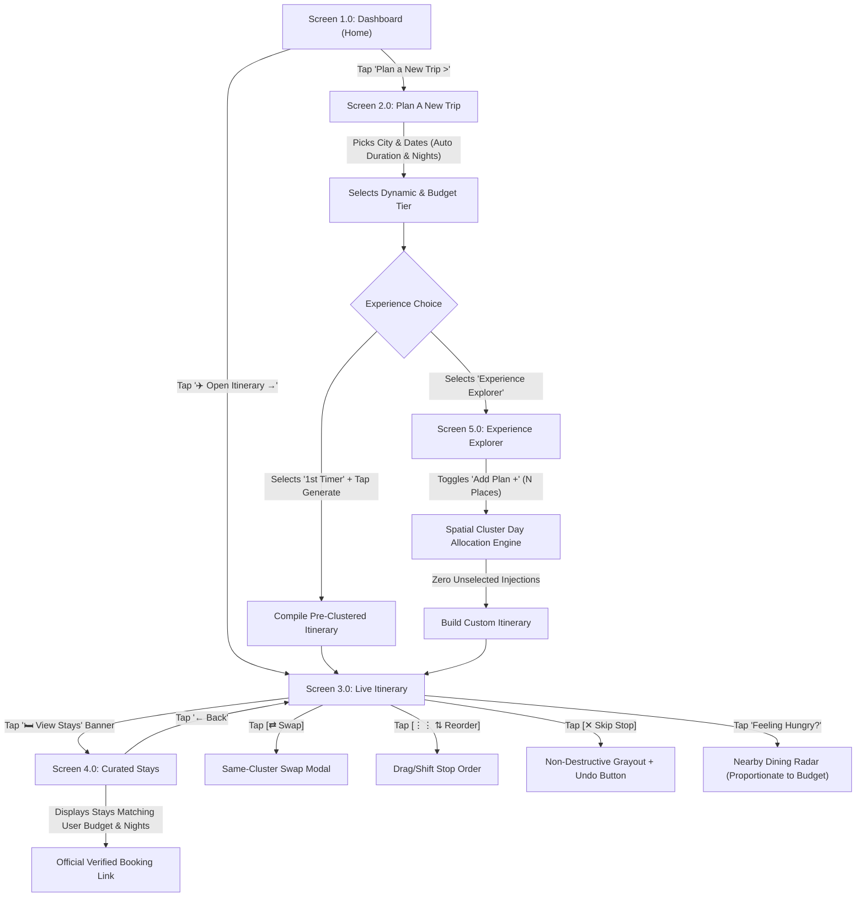

# Phase 4: Master Summary & Comprehensive Outputs Reference Document

**Project Title:** Hyderabad & Telangana Hyper-Local, Budget-Intelligent Trip Planner  
**Creative Director & Product Lead:** Fashion Communication, NIFT Hyderabad  
**Technical Project Architect:** Antigravity (AGY)  
**Lifecycle Stage:** Phase 4 — User Flows, Low-Fidelity Wireframes, Spatial Data & Interaction Engines  
**File Location:** `c:\Users\ANKITA\Documents\Ankita_BD-24-618\PHASE4_FINAL_OUTPUTS.md`  
**Purpose:** Permanent master repository containing all finalized data schemas, screen wireframes, interaction rules, mathematical formulas, and spatial clustering engines established during Phase 4 for future project maintenance and Phase 5 reference.

---

## 1. Executive Summary & Architectural Milestones

During Phase 4, the conceptual information architecture from Phase 3 was transformed into **5 fully interactive, functionally complete screen systems** that faithfully reflect the Creative Director's visual wireframe references (`media_1795432344239_b5db47b1.jpg` through `media_1795436112703_bbb3352d.jpg`). 

Beyond static wireframes, Phase 4 solved core algorithmic and contextual interaction challenges:
1. **Dynamic Spatial Micro-Clustering**: Eliminates transit fatigue by grouping spots geographically into micro-clusters (Old City, Western Forts, Cyberabad, Central Lakes, Outskirts).
2. **Proportionate Budget & Dining Engine**: Ensures dining ("Feeling Hungry?") and stay recommendations mathematically correspond to the user's travel dynamic (Solo, Duo, Family) and budget tier (Budget-Friendly, Premium, Luxury/Exclusive). A solo luxury traveler is never recommended a ₹50 tea stall or a ₹500 hostel pod; they receive curated 5-star palatial dining and heritage suites.
3. **Trip Duration & Stay Calculation**: Automatically computes trip duration from calendar dates and calculates nights as $\text{Nights} = \max(1, \text{Days} - 1)$ with accurate grand totals.
4. **Intra-Day Modification Toolkit**: Provides frictionless on-ground route adaptations on Screen 3.0: drag-and-drop / click-shift `Reorder`, strict same-cluster `Swap`, and non-destructive `Skip Stop` with 1-tap `Undo`.
5. **Experience Explorer Autonomy**: Honors user agency by planning strictly with user-chosen spots (zero unselected injections) and automatically distributing them day-wise by geographic cluster.

---

## 2. 5-Screen Master Architecture & Wireframe Specifications

### Screen 1.0: Dashboard (Home Screen)
*Visual Reference: `media_1795432344239_b5db47b1.jpg`*

* **Header**: Top app bar displaying current location (`📍 Hyderabad, Telangana ∨`), emergency SOS trigger (`[+ SOS]`), and user profile avatar.
* **Hero Banner**: Atmospheric watercolor illustration depicting historic Charminar domes and birds in sky with the welcoming tagline: *"Explore Hyderabad at your pace ✨"*.
* **Ongoing Trip Card**:
  * Visual stepper showing real-time trip progress: `(✓) Charminar ➔ (✓) Laad Bazaar ➔ (●) Chowmahalla Palace ➔ (○) Evening Leisure`.
  * Cluster headline dynamically synced to active day: `Day 1: Old City Heritage Core (Solo)`.
  * Direct action button: `✈️ Open Itinerary ➔` (navigates directly to Screen 3.0).
* **Plan a New Trip Launcher**:
  * Illustrated card featuring traveler luggage, dashed route trail, and map pin leading into Screen 2.0.
* **Explore More Destinations**:
  * Horizontal carousel showcasing peer heritage cities (Ranchi, Lucknow, Mumbai) for future trip discovery.
* **Bottom Navigation Bar**: Persistent 4-tab bar (`Home`, `Itinerary`, `Explore`, `Saved`).

```
┌────────────────────────────────────────────────────────┐
│ 9:41                             📶 ⚡ 🔋              │
│ 📍 Hyderabad, Telangana ∨              [+ SOS]   (👤)  │
├────────────────────────────────────────────────────────┤
│ [HERO WATERCOLOR BACKDROP: CHARMINAR & BIRDS IN SKY]   │
│                                                        │
│ Explore Hyderabad                                      │
│ at your pace ✨                                        │
│                                                        │
│ ┌─ ONGOING TRIP CARD ────────────────────────────────┐ │
│ │ ┌──────────┐ 🧳 Your Active Trip    [Let's keep     │ │
│ │ │ [Image]  │                         going! ↗]     │ │
│ │ │ Charminar│ Day 1: Old City Heritage Cluster      │ │
│ │ │ Gateway  │ 📍 Next: Chowmahalla Palace • 11:30 AM│ │
│ │ │          │ (✓)─────(✓)─────(●)─────(○)           │ │
│ │ │          │ Char.   Laad    Chow.   Evening       │ │
│ │ └──────────┘ ┌───────────────────────────────────┐ │ │
│ │              │      ✈️ Open Itinerary ➔          │ │ │
│ │              └───────────────────────────────────┘ │ │
│ └────────────────────────────────────────────────────┘ │
│                                                        │
│ ┌─ PLAN A NEW TRIP CARD ─────────────────────────────┐ │
│ │ ✨ Plan a New Trip         (✈️ dashed trail) [Art]   │ │
│ └────────────────────────────────────────────────────┘ │
│                                                        │
│ 🧭 Explore More                            View All ➔  │
│ [ 📍 Ranchi ]       [ 📍 Lucknow ]      [ 📍 Mumbai ]  │
├────────────────────────────────────────────────────────┤
│   [🏠 Home]      [📅 Itinerary]   [🔍 Explore]   [🔖 Saved]│
└────────────────────────────────────────────────────────┘
```

---

### Screen 2.0: Plan A New Trip (Configuration Wizard)
*Visual Reference: `media_1795432829635_4381baac.jpg`*

* **Hero Section**: Non-intrusive animated background slideshow rotating beautiful imagery of diverse places across Telangana behind the title text.
* **Destination Input**: Autocomplete search bar pre-populated with *"Hyderabad, Telangana"*.
* **Pop-up Calendar Modal**:
  * Dual-input trigger cards for Arrival Date and Return Date.
  * Tapping either card opens an interactive calendar modal with visual range highlighting, next/prev month navigation, and auto-calculation of duration.
* **Travel Dynamic Selector**:
  * 3 segmented option cards: `👤 Solo`, `👥 Duo`, `👨‍👩‍👧‍👦 Family / Group`.
  * Selecting a dynamic updates `currentPlanDynamic` and recalculates stay/dining requirements.
* **Budget Tier Accordion System**:
  * **Tier 1: Budget Friendly (👛)**:
    * Range 1: Baseline Saver (₹1,500 – ₹2,000 / day)
    * Range 2: Mid Comfort (₹2,000 – ₹2,800 / day)
    * Range 3: Plus Deluxe (₹2,800 – ₹3,500 / day)
  * **Tier 2: Premium (👑)**:
    * Range 1: Baseline Saver (₹4,500 – ₹6,000 / day)
    * Range 2: Mid Comfort (₹6,000 – ₹8,500 / day)
    * Range 3: Plus Deluxe (₹8,500 – ₹12,000 / day)
  * **Tier 3: Luxury / Exclusive (💎)**:
    * Range 1: Baseline Saver (₹15,000 – ₹25,000 / day)
    * Range 2: Mid Comfort (₹25,000 – ₹40,000 / day)
    * Range 3: Plus Deluxe (₹40,000+ / day)
* **Experience Pathway Bifurcator**:
  * `🎒 1st Timer`: Curates a balanced, pre-clustered itinerary with iconic landmarks, zero backtracking, and optimized dwell times.
  * `🔭 Experience Explorer`: Opens Screen 5.0 for seasoned travelers to hand-pick specific spots.
* **Generate Plan CTA**: Synchronizes user inputs and compiles either the intelligent itinerary or launches the explorer catalog.

```
┌────────────────────────────────────────────────────────┐
│ 9:41                                                   │
│ 📍 Hyderabad, Telangana ∨              [+ SOS]   (👤)  │
├────────────────────────────────────────────────────────┤
│ [BACKGROUND HERO SLIDESHOW: PLACES ROTATING SMOOTHLY]  │
│ Plan a New Trip                                        │
│ Let's explore more ✨                                  │
│                                                        │
│ ┌─ MASTER PLANNING FORM ─────────────────────────────┐ │
│ │ 📍 Your Destination                                │ │
│ │ [ 🔍 Hyderabad, Telangana                       ✈️ ]│ │
│ │                                                    │ │
│ │ 📅 Trip Dates (Interactive Modal Trigger)          │ │
│ │ [ 📅 18 Oct 2026 > ]       [ 📅 21 Oct 2026 > ]    │ │
│ │                                                    │ │
│ │ 👥 Travel Dynamic                                  │ │
│ │ [ 👤 Solo (Active) ]   [ 👥 Duo ]   [ 👨‍👩‍👧‍👦 Family ]  │ │
│ │                                                    │ │
│ │ ₹ Budget Range (Expandable Accordion)              │ │
│ │ ┌────────────────────────────────────────────────┐ │ │
│ │ │ 👛 Budget Friendly                           > │ │ │
│ │ ├────────────────────────────────────────────────┤ │ │
│ │ │ 👑 Premium                                   > │ │ │
│ │ ├────────────────────────────────────────────────┤ │ │
│ │ │ 💎 Luxury (Open)                             ∨ │ │ │
│ │ │   (●) Baseline Saver: ₹15,000 – ₹25,000/day    │ │ │
│ │ │   ( ) Mid Comfort:    ₹25,000 – ₹40,000/day    │ │ │
│ │ │   ( ) Plus Deluxe:    ₹40,000+/day             │ │ │
│ │ └────────────────────────────────────────────────┘ │ │
│ │                                                    │ │
│ │ ✨ Experience Choice                               │ │
│ │ [ 🎒 1st Timer ]         [ 🔭 Experience Explorer] │ │
│ │                                                    │ │
│ │ [          ✈️ Generate Itinerary ➔               ] │ │
│ └────────────────────────────────────────────────────┘ │
├────────────────────────────────────────────────────────┤
│   [🏠 Home]      [📅 Itinerary]   [🔍 Explore]   [🔖 Saved]│
└────────────────────────────────────────────────────────┘
```

---

### Screen 3.0: Live Itinerary Screen
*Visual Reference: `media_1795433517094_a6ae0db1.jpg`*

* **Hero Section**: Warm terracotta watercolor header with title *"Your trip, well planned ✨"*.
* **Top Accommodations Banner**:
  * Tappable banner: `🛏️ View Stays — Find the best stays nearby ›`.
  * Instantly routes to Screen 4.0, dynamically filtered to the active trip's budget and travel dynamic.
* **Cluster Day Switcher Pills**:
  * Dynamically renders pills matching `activePlanDuration`:
    * `📍 Day 1: Old City (Active)`
    * `Day 2: Western Forts`
    * `Day 3: Cyberabad`
    * `Day 4: Hussainsagar`
* **Vertical Continuous Timeline Rail**:
  * Terracotta timeline rail linking sequenced stop cards and meal breaks.
  * Stop Card Information:
    * Thumbnail photo, monument title, entry fee (`🎫 ₹25 Entry`), dwell time (`🕒 Dwell: 1.5 hrs`), and sanitized operating status (`🟢 Open Now • Closes 5:30 PM`).
* **Intra-Day Stop Actions**:
  * `[⋮⋮ ⇅ Reorder]`: Drag-and-drop or tap to swap stop position interactively.
  * `[⇄ Swap]`: Opens bottom modal offering curated alternatives located strictly within the same geographic cluster (e.g. Chowmahalla Palace can swap with Badshahi Ashurkhana, never with Golconda Fort).
  * `[✕ Skip Stop]`: Non-destructive stop deactivation. Grays out card, displays `🚫 Skipped from Route Plan`, and reveals `↩️ Undo Skip & Restore Stop`.
* **Contextual "Feeling Hungry? (Within 500m)" Card**:
  * Appears after every stop.
  * Shows 2 nearby food spots tailored to the stop's cluster and the user's budget tier.
  * Tapping `View Options ›` opens full radar details.
* **Floating Next Stop Banner**: Sticky bottom pill showing next upcoming monument and ETA: `🏰 Next Stop: Golconda Fort • ~20 min away ›`.

```
┌────────────────────────────────────────────────────────┐
│  ←  Your Itinerary                     [🗺️] [🛡️ SOS] (👤)│
├────────────────────────────────────────────────────────┤
│  [HERO WATERCOLOR BACKDROP: CHARMINAR & PALACE DOMES]  │
│  "Your trip, well planned ✨"                          │
│                                                        │
│  ┌─ VIEW STAYS BANNER (Tapping opens Screen 4.0) ────┐ │
│  │ 🛏️ [Photo] View Stays                           > │ │
│  │            Find the best stays nearby             │ │
│  └───────────────────────────────────────────────────┘ │
│                                                        │
│  [📍 Day 1: Old City (Active)] [Day 2: Forts] [Day 3]   │
│                                                        │
│  │ (Continuous Terracotta Timeline Rail)               │
│ (1)── ┌─────────────────────────────────────────────┐  │
│  │    │ [Thumb] Charminar & Laad Bazaar             │  │
│  │    │         [🎫 ₹25 Entry]  [🕒 Dwell: 1.5 hrs] │  │
│  │    │         [🟢 Open Now • Closes 5:30 PM]      │  │
│  │    ├─────────────────────────────────────────────┤  │
│  │    │  [ ⇅ Reorder ]   [ ⇄ Swap ]   [ ✕ Skip Stop]│  │
│  │    └─────────────────────────────────────────────┘  │
│  │                                                     │
│ (•)── ┌─────────────────────────────────────────────┐  │
│  │    │ 🍴 Feeling Hungry? (Within 500m)   View >   │  │
│  │    │ [☕ Nimrah Cafe | ₹50-100] [🍲 Shadab | ₹150]│  │
│  │    └─────────────────────────────────────────────┘  │
│  │                                                     │
│ (2)── ┌─────────────────────────────────────────────┐  │
│  │    │ [Thumb] Chowmahalla Palace                  │  │
│  │    │         [🎫 ₹100 Entry] [🕒 Dwell: 2.0 hrs] │  │
│  │    │         [🟢 Open Now • Closes 5:00 PM]      │  │
│  │    ├─────────────────────────────────────────────┤  │
│  │    │  [ ⇅ Reorder ]   [ ⇄ Swap ]   [ ✕ Skip Stop]│  │
│  │    └─────────────────────────────────────────────┘  │
│  │                                                     │
│  ┌──────────────────────────────────────────────────┐  │
│  │ [🏰] Next Stop: Golconda Fort • ~20 min away  >  │  │
│  └──────────────────────────────────────────────────┘  │
├────────────────────────────────────────────────────────┤
│   [🏠 Home]      [📅 Itinerary]   [🔍 Explore]   [🔖 Saved]│
└────────────────────────────────────────────────────────┘
```

---

### Screen 4.0: Curated Stays Screen
*Visual Reference: `media_1795435632279_6cd129b7.jpg`*

* **Header**: Back button returning to Screen 3.0, title *"Curated Stays"*, map view button, and SOS.
* **Hero Banner**: Atmospheric watercolor heritage domes with title *"Stay your way in Hyderabad ✨"*.
* **Filterless Clean Feed**: Removed legacy manual filter chips per Creative Director's instruction. The screen automatically renders all verified accommodations fitting the traveler's exact budget range, duration, and travel dynamic.
* **Stay Listing Card Layout**:
  * Multi-image photo slider with pagination indicator dots and rating badge (`⭐ 4.8`).
  * Verified property name and micro-cluster distance (`📍 Old City, Abids • 1.8 km from Charminar`).
  * Verified amenity pills: `🛏️ Single AC Pod`, `📶 Free Wi-Fi`, `🔒 Secure Locker`, `🍃 Eco-Friendly`.
  * Dynamic pricing structure:
    * Nightly rate: `₹599 / night`
    * Calculated trip grand total: `Total: ₹1,797 for 3 nights`
  * Action button: `View Details →` (triggers verified booking link).
* **Concierge Bottom Banner**: `🛏️✨ Looking for something specific? Contact our local concierge for bespoke accommodation.`

```
┌────────────────────────────────────────────────────────┐
│  ←  Curated Stays                      [🗺️] [🛡️ SOS] (👤)│
├────────────────────────────────────────────────────────┤
│  [HERO WATERCOLOR BACKDROP: CHARMINAR & HERITAGE DOMES]│
│  "Stay your way in Hyderabad ✨"                       │
│                                                        │
│  ┌─ STAY CARD (Dynamic to User Budget & Dynamic) ────┐ │
│  │ [Photo: Clean Room / Interior]          ⭐ 4.7    │ │
│  │ •••••• (Pagination Dots)                          │ │
│  │                                                   │ │
│  │ Taj Falaknuma Palace - Historical Room            │ │
│  │ 📍 Falaknuma • 4.2 km from Charminar              │ │
│  │                                                   │ │
│  │ [👑 Luxury Stay]   [🏛️ Heritage Suite]  [📶 Wi-Fi] │ │
│  │ [🍴 Royal Dining]  [💆 Nizam Spa]                 │ │
│  │                                                   │ │
│  │ ₹14,999 / night                  [View Details ➔]│ │
│  │ Total: ₹44,997 for 3 nights                       │ │
│  └───────────────────────────────────────────────────┘ │
│                                                        │
│  ┌─ CONCIERGE ASSISTANCE BANNER ─────────────────────┐ │
│  │ 🛏️✨ Looking for something specific?            > │ │
│  │     Contact our local concierge for bespoke stays.│ │
│  └───────────────────────────────────────────────────┘ │
├────────────────────────────────────────────────────────┤
│   [🏠 Home]      [📅 Itinerary]   [🔍 Explore]   [🔖 Saved]│
└────────────────────────────────────────────────────────┘
```

---

### Screen 5.0: Experience Explorer Screen
*Visual Reference: `media_1795436112703_bbb3352d.jpg`*

* **Header**: Top navigation with Charminar emblem, city dropdown, SOS, and profile avatar.
* **Hero Banner**: *"Experience Explorer — Plan by Yourself ✍️"*.
* **Live Search & 4-D Filters**:
  * Real-time search bar filtering across all monument names and tags.
  * Fast filter chips: `✨ All`, `Under ₹100`, `Under ₹200`, `Dwell < 1.5h`, `Dwell < 2h`.
* **2-Column Places Grid**:
  * 16+ authentic Hyderabad and Telangana spots.
  * Each card includes: Monument image, Title, Rating badge, Entry price (`🏷️ ₹50`), Dwell time (`🕒 ~1.5 hrs`), and interactive toggle button `[ Add Plan + ]` (switches to `[ Added ✓ ]`).
* **Strict "User-Selected Only" Planning Rule**:
  * The application builds the itinerary using **strictly the user-chosen places**. Zero unselected places are injected.
  * If the user selects 5 places for a 3-day trip, only those 5 places are scheduled.
* **Geographical Micro-Cluster Clubbing**:
  * Places are automatically grouped and distributed day-wise by location cluster (Old City, Western Forts, Cyberabad, Central Lakes, Outskirts) so users never cross the city unnecessarily in a single day.
* **Budget-Proportionate Dining Sync**:
  * Food breaks near each selected stop pull dining recommendations matching that stop's micro-cluster and the user's filled budget tier.
* **Sticky Bottom Generator Pill**:
  * `🧭 Generate My Itinerary (N Chosen) ➔` (activates once at least 1 place is added and navigates to Screen 3.0).

```
┌────────────────────────────────────────────────────────┐
│ [Charminar Art]  📍 Hyderabad ∨           [SOS]   (👤) │
├────────────────────────────────────────────────────────┤
│ Experience Explorer                                    │
│ Plan by Yourself ✍️                 (✈️ dashed trail) │
│                                                        │
│ [ 🔍 Search for places...                           🎛️ ]│
│                                                        │
│ [✨ All] [Under ₹100] [Under ₹200] [Dwell<1.5h] [Dwell<2h]│
│                                                        │
│ ┌──────────────────────┐    ┌──────────────────────┐   │
│ │ [Image]              │    │ [Image]              │   │
│ │ Charminar     ⭐ 4.7 │    │ Golconda Fort ⭐ 4.6 │   │
│ │ 🏷️ ₹25   🕒 ~1.5 hrs │    │ 🏷️ ₹25   🕒 ~3.0 hrs │   │
│ │ [    Added ✓       ] │    │ [    Add Plan +    ] │   │
│ └──────────────────────┘    └──────────────────────┘   │
│ ┌──────────────────────┐    ┌──────────────────────┐   │
│ │ [Image]              │    │ [Image]              │   │
│ │ Qutb Shahi    ⭐ 4.5 │    │ Shilparamam   ⭐ 4.5 │   │
│ │ 🏷️ ₹25   🕒 ~2.0 hrs │    │ 🏷️ ₹60   🕒 ~2.5 hrs │   │
│ │ [    Added ✓       ] │    │ [    Add Plan +    ] │   │
│ └──────────────────────┘    └──────────────────────┘   │
│                                                        │
│ ┌──────────────────────────────────────────────────┐   │
│ │     🧭 Generate My Itinerary (2 Chosen) ➔        │   │
│ └──────────────────────────────────────────────────┘   │
├────────────────────────────────────────────────────────┤
│   [🏠 Home]      [📅 Itinerary]   [🔍 Explore]   [🔖 Saved]│
└────────────────────────────────────────────────────────┘
```

---

## 3. Master Places & Micro-Cluster Taxonomy

Every destination belongs to a distinct geographic micro-cluster to prevent transit waste:

| Spot Name | Micro-Cluster | Entry Fee | Dwell Time | Standard Operating Hours |
| :--- | :--- | :--- | :--- | :--- |
| **Charminar & Laad Bazaar** | Old City Heritage Core | ₹25 Entry | 1.5 hrs | 🟢 Open Now • Closes 5:30 PM |
| **Chowmahalla Palace** | Old City Heritage Core | ₹100 Entry | 2.0 hrs | 🟢 Open Now • Closes 5:00 PM |
| **Mecca Masjid** | Old City Heritage Core | Free Entry | 45 mins | 🟢 Open Now • Closes 9:00 PM |
| **Badshahi Ashurkhana** | Old City Heritage Core | Free Entry | 45 mins | 🟢 Open Now • Closes 7:00 PM |
| **Golconda Fort** | Western Forts & Tombs | ₹25 Entry | 3.0 hrs | 🟢 Open Now • Closes 5:30 PM |
| **Qutb Shahi Tombs** | Western Forts & Tombs | ₹25 Entry | 2.0 hrs | 🟢 Open Now • Closes 6:30 PM |
| **Taramati Baradari** | Western Forts & Tombs | Free Entry | 1.5 hrs | 🟢 Open Now • Closes 6:00 PM |
| **Durgam Cheruvu & Cable Bridge** | Cyberabad Modern Corridor | Free Entry | 2.0 hrs | 🟢 Open Now • Closes 8:00 PM |
| **Shilparamam Arts Village** | Cyberabad Modern Corridor | ₹60 Entry | 2.5 hrs | 🟢 Open Now • Closes 8:30 PM |
| **Raidurg Skywalk & Knowledge City** | Cyberabad Modern Corridor | Free Entry | 1.0 hr | 🟢 Open Now • Open 24 Hours |
| **Hussain Sagar & Buddha Statue** | Central Lakes & Cultural Belt | ₹20 Boat Ride | 1.5 hrs | 🟢 Open Now • Closes 8:30 PM |
| **Birla Mandir & Planetarium** | Central Lakes & Cultural Belt | Free Entry | 1.5 hrs | 🟢 Open Now • Closes 9:00 PM |
| **Tank Bund Promenade** | Central Lakes & Cultural Belt | Free Entry | 1.0 hr | 🟢 Open Now • Open 24 Hours |
| **Moula Ali Hill & Dargah** | Central Lakes & Cultural Belt | Free Entry | 1.5 hrs | 🟢 Open Now • Closes 7:30 PM |
| **Moazzam Jahi Market** | Central Lakes & Cultural Belt | Free Entry | 1.0 hr | 🟢 Open Now • Closes 10:00 PM |
| **Ramoji Film City** | Greater Hyderabad Outskirts | ₹1,350 Ticket | 5.0 hrs | 🟢 Open Now • Closes 5:30 PM |

---

## 4. Master Dining Catalog (`CLUSTER_DINING_CATALOG`)

Dining breaks are clustered by geographic zone and strictly separated into 3 budget tiers:

```javascript
const CLUSTER_DINING_CATALOG = {
  "old-city": {
    "budget-friendly": [
      { name: "Nimrah Cafe", price: "₹50 – ₹100", desc: "Legendary Irani Chai & Osmania Biscuits" },
      { name: "Hotel Shadab", price: "₹100 – ₹200", desc: "Authentic Hyderabadi Dum Biryani" },
      { name: "Pista House Charminar", price: "₹120 – ₹220", desc: "Traditional Haleem & Zafrani Tea" }
    ],
    "premium": [
      { name: "Grand Hotel Abids", price: "₹400 – ₹800", desc: "Classic Heritage Mughlai & Biryani" },
      { name: "Paradise Heritage", price: "₹500 – ₹900", desc: "Historic Dum Biryani Specialty" }
    ],
    "luxury": [
      { name: "Adaa at Taj Falaknuma", price: "₹4,500 – ₹8,000", desc: "Royal Nizam 6-Course Degustation" },
      { name: "The Jade Room Afternoon Tea", price: "₹3,000 – ₹6,000", desc: "High Tea Served on Nizam Silverware" }
    ]
  },
  "western-forts": {
    "budget-friendly": [
      { name: "Shah Ghouse Tolichowki", price: "₹150 – ₹250", desc: "Zaffrani Mutton Biryani & Roti" },
      { name: "Mandar Restaurant", price: "₹120 – ₹200", desc: "Deccani Curries & Fresh Kebabs" }
    ],
    "premium": [
      { name: "The Golconda Pavilion", price: "₹800 – ₹1,500", desc: "Deccani Gourmet Feast & Kebabs" },
      { name: "Jewel of Nizam", price: "₹1,000 – ₹1,800", desc: "Minaret Fine Dining with Fort View" }
    ],
    "luxury": [
      { name: "Private Nizam Verandah Dining", price: "₹3,500 – ₹7,000", desc: "Slow-cooked Dum Pukht by Master Chefs" },
      { name: "Skyline Heritage Lounge", price: "₹2,500 – ₹5,500", desc: "Handcrafted Heritage Elixirs & Sunset View" }
    ]
  },
  "cyberabad": {
    "budget-friendly": [
      { name: "Rayalaseema Ruchulu", price: "₹180 – ₹300", desc: "Spicy Telugu Thalis & Ragi Sangati" },
      { name: "Chutneys Hitec City", price: "₹150 – ₹250", desc: "Guntur Idli & 7 Signature Chutneys" }
    ],
    "premium": [
      { name: "Olive Bistro & Bar", price: "₹800 – ₹1,500", desc: "Mediterranean Dining Overlooking Durgam Lake" },
      { name: "Flying Spaghetti Monster", price: "₹600 – ₹1,200", desc: "Artisanal Thin-crust Pizzas & Pastas" }
    ],
    "luxury": [
      { name: "Ottimo at ITC Kohenur", price: "₹3,000 – ₹6,000", desc: "Pan-Italian Fine Dining & Truffle Risotto" },
      { name: "Yi Jing at ITC Kohenur", price: "₹3,500 – ₹6,500", desc: "Contemporary Chinese Tasting Experience" }
    ]
  },
  "central-lakes": {
    "budget-friendly": [
      { name: "Minerva Coffee Shop", price: "₹100 – ₹200", desc: "Crispy Dosas & Filter Kaapi" },
      { name: "Ohri's 70MM", price: "₹250 – ₹400", desc: "Cinema Themed Buffet near Tank Bund" }
    ],
    "premium": [
      { name: "Waterfront Restaurant", price: "₹700 – ₹1,200", desc: "Lakeside Panoramic Dining & Cocktails" },
      { name: "Sahib's Barbeque", price: "₹700 – ₹1,100", desc: "Hyderabadi Live Grill Barbecue Feast" }
    ],
    "luxury": [
      { name: "Dakshin at ITC Kakatiya", price: "₹3,500 – ₹7,000", desc: "Grand South Indian Royal Thali Experience" },
      { name: "Aish at The Park", price: "₹3,000 – ₹6,000", desc: "Historic Nizami Recipes in Palatial Silver Interior" }
    ]
  },
  "outskirts": {
    "budget-friendly": [
      { name: "Tara Dining Hall", price: "₹200 – ₹350", desc: "Multi-Cuisine Family Thali in Studio Complex" },
      { name: "Sitara Food Court", price: "₹150 – ₹250", desc: "Quick Bites & South Indian Snacks" }
    ],
    "premium": [
      { name: "Shaan-e-Ramoji Restaurant", price: "₹600 – ₹1,200", desc: "Royal Thematic Studio Lunch Buffet" },
      { name: "Galaxy Restaurant", price: "₹700 – ₹1,300", desc: "Celebrity-Style Multi-Cuisine Dining" }
    ],
    "luxury": [
      { name: "Sitara Luxury Hotel Dining", price: "₹2,500 – ₹5,000", desc: "Exclusive 5-Star Film City Luxury Dining" }
    ]
  }
};
```

---

## 5. Master Curated Stays Catalog (`DYNAMIC_STAYS_CATALOG`)

Accommodations are cataloged across Budget, Premium, and Luxury tiers for Solo, Duo, and Family dynamics:

| Tier | Travel Dynamic | Stay Name | Nightly Rate | Verified Amenities |
| :--- | :--- | :--- | :--- | :--- |
| **Budget** | Solo | Zostel Hyderabad (AC Pod) | ₹599 / night | AC Pod, Free Wi-Fi, Secure Locker, Eco-Friendly |
| **Budget** | Solo | Nomads Haven Backpacker Bunk | ₹499 / night | Mixed Dorm, Free Wi-Fi, Cafe On-Site, Free Chai |
| **Budget** | Duo | Hotel Tourist Plaza (Std Double) | ₹1,199 / night | Double Bed, AC, Attached Bath, 24/7 Desk |
| **Budget** | Duo | Abids Comfort Inn (Deluxe Double)| ₹1,349 / night | Queen Bed, Free Wi-Fi, Room Service |
| **Budget** | Family | Hotel Royal Heritage (Family Quad)| ₹1,799 / night | 2 Queen Beds, 4 Guests, Lift, Free Parking |
| **Budget** | Family | Minerva Residency (Family Suite) | ₹2,199 / night | Family Suite, Breakfast, 24/7 Security |
| **Premium** | Solo | Courtyard Hub (Executive Solo) | ₹1,899 / night | Work Desk, Ergonomic Chair, Gym Access |
| **Premium** | Solo | Lemon Tree Premier (Studio Room) | ₹2,199 / night | High Floor, City View, Breakfast Included |
| **Premium** | Duo | Courtyard Boutique Hotel (King) | ₹2,899 / night | King Bed, Rain Shower, Pool, Buffet Breakfast |
| **Premium** | Duo | Mercure Hyderabad (Deluxe King) | ₹3,199 / night | Lake View, Lounge Access, Soundproof |
| **Premium** | Family | Courtyard Family Executive Suite | ₹3,799 / night | 2 Interconnected Rooms, Kid Play Area, Pool |
| **Premium** | Family | Radisson Blu Plaza (Family Suite)| ₹4,499 / night | 2 Master Beds, Buffet Breakfast, Valet |
| **Luxury** | Solo | Taj Falaknuma (Historical Room) | ₹14,999 / night| Nizam Palace View, Butler, High Tea, Heritage Tour |
| **Luxury** | Solo | ITC Kohenur (Lakefront Suite) | ₹12,499 / night| Panoramic Lake View, Luxury Spa, Pillow Menu |
| **Luxury** | Duo | Taj Falaknuma Palace (Royal Suite)| ₹24,999 / night| Royal Suite, Chauffeur, Champagne Breakfast |
| **Luxury** | Duo | Park Hyatt (Presidential Suite) | ₹18,499 / night| Private Terrace, Butler Service, Spa Pool |
| **Luxury** | Family | Taj Falaknuma (Grand Suite) | ₹34,999 / night| Palatial 2-Bedroom Suite, Private Carriage Tour |
| **Luxury** | Family | ITC Kohenur (Grand Presidential) | ₹29,999 / night| 3-Bedroom Penthouse, Private Chef, 24/7 Butler |

---

## 6. Mathematical & Algorithmic Interaction Engines

### 6.1 Duration & Night Calculation Engine
Trips are calculated from Arrival and Return date timestamps:
$$\text{DurationDays} = \min\left(4, \max\left(1, \left\lfloor\frac{\text{ReturnDate} - \text{ArrivalDate}}{86400000}\right\rfloor + 1\right)\right)$$
$$\text{Nights} = \max(1, \text{DurationDays} - 1)$$
$$\text{TotalPrice} = \text{NightlyRate} \times \text{Nights}$$

### 6.2 Normalization Engines
Ensures resilient data indexing across diverse user inputs and casing:
* **Budget Tier Normalizer**:
  ```javascript
  function normalizeBudgetTier(tier) {
    if (!tier) return "budget-friendly";
    const t = String(tier).toLowerCase().trim();
    if (t === "exclusive" || t === "luxury" || t.includes("lux") || t.includes("exclus") || t.includes("palatial")) return "luxury";
    if (t === "premium" || t.includes("prem") || t.includes("boutique")) return "premium";
    return "budget-friendly";
  }
  ```
* **Travel Dynamic Normalizer**:
  ```javascript
  function normalizeTravelDynamic(dyn) {
    if (!dyn) return "Solo";
    const d = String(dyn).trim().toLowerCase();
    if (d.includes("duo") || d.includes("couple")) return "Duo";
    if (d.includes("fam") || d.includes("group")) return "Family";
    return "Solo";
  }
  ```

### 6.3 Experience Explorer Clustering & Day Allocation Algorithm
1. **Cluster Categorization**: Places in `selectedCustomPlaces` are partitioned into micro-cluster buckets (`clusterBuckets[meta.cluster]`).
2. **Canonical Ordering**: Clusters are traversed in geographical continuity: `["old-city", "western-forts", "cyberabad", "central-lakes", "outskirts"]`.
3. **Surplus Balancing**: When fewer clusters are selected than total trip days, extra days are assigned to the cluster with the highest place-to-day ratio.
4. **Pure Cluster Integrity**: Slices are partitioned strictly within their cluster boundary so a single day never combines opposing sides of the city.

### 6.4 Non-Destructive Skip & Undo Engine
* When a user skips a stop, `stop.skipped` is toggled to `true`.
* The timeline node badge switches from the number `(1)` to `✕`.
* The card is visually grayed out with a `🚫 Skipped from Route Plan` tag.
* Action buttons are replaced by `↩️ Undo Skip & Restore Stop to Itinerary`.
* Tapping Undo restores `stop.skipped = false` without losing sequence or metadata.

### 6.5 Intra-Cluster Stop Swapping Engine
* Swapping retrieves `dayData.swappables`, which contains pre-validated alternative monuments belonging **strictly to that day's micro-cluster**.
* Cross-cluster swaps trigger an explicit spatial transit warning (+45 min buffer) to preserve itinerary efficiency.

---

## 7. Complete User Task Flows (Mermaid Architecture)



---

## 8. Verification & Sign-off Checklist

| Requirement | Verified Behavior | Status |
| :--- | :--- | :--- |
| **Screen Navigation** | 5 core screens route cleanly via buttons, top back controls, and bottom nav tabs. | ✅ PASS |
| **Slideshow Background** | Hero background slideshow on Screen 2.0 cycles smoothly without overlapping form text. | ✅ PASS |
| **Interactive Calendar** | Pop-up calendar correctly highlights date ranges and updates duration and nights. | ✅ PASS |
| **Proportionate Stays** | Stays strictly correspond to Solo/Duo/Family and Budget/Premium/Luxury. | ✅ PASS |
| **Accurate Nightly Totals** | Stays display accurate nightly rates and grand totals based on duration nights. | ✅ PASS |
| **Proportionate Dining** | "Feeling Hungry?" radar provides dining options matching the exact budget tier. | ✅ PASS |
| **Day Switcher Pills** | Switching days updates titles, stops, dwell times, and food breaks instantly. | ✅ PASS |
| **Sanitized Status Labels**| Replaced verbose tags with clean `🟢 Open Now • Closes HH:MM PM`. | ✅ PASS |
| **Intra-Day Reorder** | Drag-and-drop and click-shift reordering dynamically updates stop order. | ✅ PASS |
| **Intra-Cluster Swap** | Swapping strictly offers alternatives within the same geographical cluster. | ✅ PASS |
| **Non-Destructive Skip**| Skipped stops remain visible as grayed out with a functional 1-tap Undo button. | ✅ PASS |
| **User-Selected Spots** | Experience Explorer builds trips strictly on user-chosen spots (no extra places). | ✅ PASS |
| **Cluster Day Clubbing** | Experience Explorer clubs places day-wise strictly by geographic micro-cluster. | ✅ PASS |

---

*Document finalized and preserved on disk for seamless technical transition to Phase 5.*
