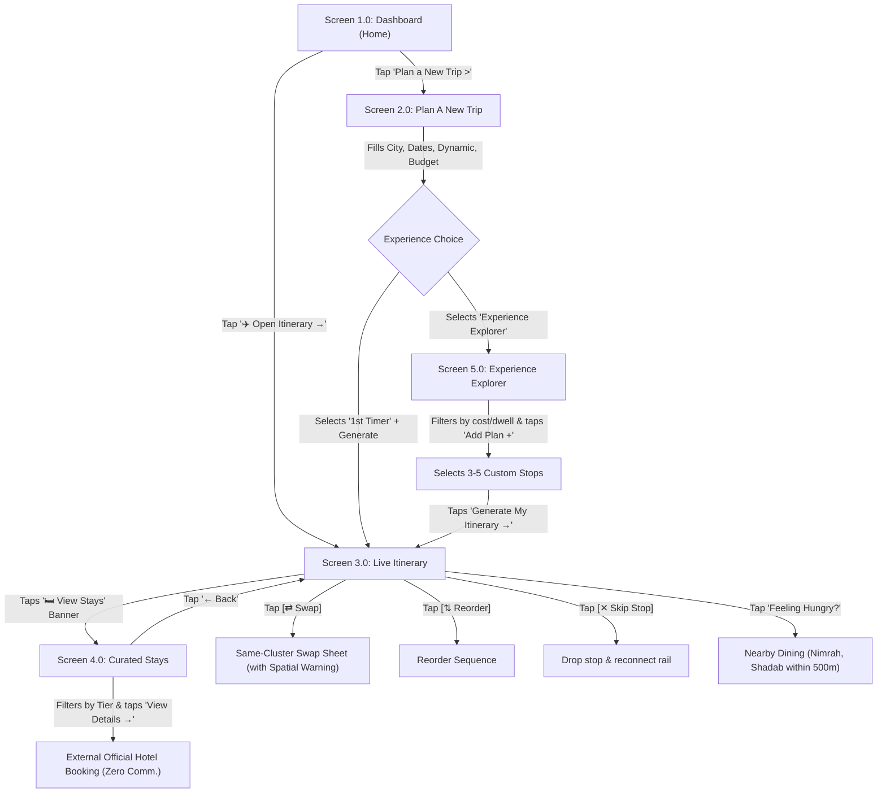

# Phase 4: Master Summary & Outputs Reference Document

**Project Title:** Hyderabad & Telangana Hyper-Local, Budget-Intelligent Trip Planner  
**Creative Director & Product Lead:** NIFT Hyderabad  
**Technical Project Architect:** AGY  
**Lifecycle Stage:** Phase 4 — User Flows & Low-Fidelity Wireframes (Master Outputs)  
**Document Purpose:** Central master reference for the locked 5-Screen Inventory, structural wireframes, user task flows, interaction states, and screen architectures established during Phase 4, directly corresponding to the 5 official design references (`media_1795432344239_b5db47b1.jpg` through `media_1795436112703_bbb3352d.jpg`).

---

## 1. Executive Summary & Phase 4 Milestone Achievements

In Phase 4, the Information Architecture from Phase 3 has been converted into **5 fully specified, structural screen layouts and cohesive user task flows**. Every screen is derived directly from the Creative Director’s official high-fidelity references and design steering.

### Key Architectural Pillars:
1. **5-Screen Master Architecture:** 
   - **Screen 1.0:** Dashboard (Home Screen) with Ongoing Trip progress stepper & Plan a New Trip entry.
   - **Screen 2.0:** Plan A New Trip (Single-Page Setup) with destination autocomplete, date pickers, dynamic selection, 3-tier budget ranges, and dual experience pathways.
   - **Screen 3.0:** Live Itinerary (Timeline Execution) with top "View Stays" banner, day switcher pills, vertical timeline rail, intra-day modification tools (`Reorder`, `Swap`, `Skip Stop`), and nearby food radar.
   - **Screen 4.0:** Curated Stays (Accommodations Finder) with budget tier filters, amenity chips, pricing per night, and direct official booking links.
   - **Screen 5.0:** Experience Explorer (Self-Planning Catalog) with search bar, 4-D filter pills, 2-column place cards with `Add Plan +` buttons, and itinerary generation into the Screen 3.0 layout.
2. **Zero Transit-Waste Spatial Clustering:** Seamless intra-day execution where 1st timers receive pre-clustered routes and return explorers assemble custom itineraries with spatial sanity checks.
3. **Dedicated Stays Decoupling:** Accommodations are housed in their own dedicated discovery space (Screen 4.0) accessible directly from the Live Itinerary.
4. **Contextual Food Break Radars:** Integrated within-500m dining recommendations directly into the timeline after key visits.

---

## 2. Master Screen Inventory

| Screen ID | Screen Name | Reference Image | Core Functionality | Primary Actions |
| :--- | :--- | :--- | :--- | :--- |
| **Screen 1.0** | **Dashboard (Home Screen)** | `media_1795432344239_b5db47b1.jpg` | Landing hub with active trip progress, new trip launcher & horizontal destination recommendations | • Tap `✈️ Open Itinerary →`<br>• Tap `Plan a New Trip >`<br>• Browse `Explore More` horizontal carousel (Ranchi, Lucknow, Mumbai)<br>• 1-Tap `SOS` & location dropdown |
| **Screen 2.0** | **Plan A New Trip Screen** | `media_1795432829635_4381baac.jpg` | Single-page scrollable trip configuration wizard with slideshow and tiered preferences | • Search City with Autocomplete<br>• Pick Arrival Date & Return Date<br>• Select Dynamic (`Solo`, `Duo`, `Family`)<br>• Select Budget Tier (`Budget Friendly`, `Premium`, `Luxury`) with 3 sub-ranges each<br>• Choose Experience (`1st Timer` vs `Experience Explorer`)<br>• Tap `✈️ Generate Itinerary →` |
| **Screen 3.0** | **Live Itinerary Screen** | `media_1795433517094_a6ae0db1.jpg` | Step-by-step active navigation companion with heritage watercolor banner, timeline rail & food radar | • Tap `🛏️ View Stays` banner ➔ opens Screen 4.0<br>• Switch Days (`Day 1: Old City`, `Day 2`, `Day 3`)<br>• `[⇅ Reorder]` stops<br>• `[⇄ Swap]` stop (opens same-cluster recommendations)<br>• `[✕ Skip Stop]`<br>• View nearby dining (`Nimrah Cafe`, `Shadab`)<br>• View floating `Next Stop Golconda Fort` banner<br>• Back button `←` returns to Dashboard |
| **Screen 4.0** | **Curated Stays Screen** | `media_1795435632279_6cd129b7.jpg` | Dedicated accommodations finder categorized by budget tier with verified hygiene & cluster distance | • Filter by Tier (`All Stays`, `Budget-Friendly`, `Premium`, `Exclusive`)<br>• Browse verified listings with photo carousels & amenity badges<br>• Tap `View Details →` (Official hotel booking link)<br>• Tap bottom banner `Looking for something specific?`<br>• Back button `←` returns to Screen 3.0 |
| **Screen 5.0** | **Experience Explorer Screen** | `media_1795436112703_bbb3352d.jpg` | Self-curated planning workspace for experienced travelers to choose specific spots | • Search places with live keyword filter<br>• Filter by cost & dwell pills (`Under ₹100`, `Dwell < 1.5hr`)<br>• Tap `Add Plan +` on 2-column place cards<br>• Tap sticky `Generate My Itinerary →` ➔ builds custom itinerary in Screen 3.0 layout |

---

## 3. Structural Wireframe Layouts & ASCII Schematics

### Screen 1.0: Dashboard (Home Screen)
*Reference: `media_1795432344239_b5db47b1.jpg`*

```
┌────────────────────────────────────────────────────────┐
│ 9:41                             📶 ⚡ 🔋              │
│ 📍 Hyderabad, Telangana ∨              [+ SOS]   (👤)  │
├────────────────────────────────────────────────────────┤
│ [HERO WATERCOLOR BACKDROP: CHARMINAR & BIRDS IN SKY]   │
│                                                        │
│ Explore Hyderabad                                      │
│ at your pace ✨                                        │
│                                                        │
│ ┌─ ONGOING TRIP CARD ────────────────────────────────┐ │
│ │ ┌──────────┐ 🧳 Your Active Trip    [Let's keep     │ │
│ │ │ [Image]  │                         going! ↗]     │ │
│ │ │ Charminar│ Day 1: Old City Heritage Cluster      │ │
│ │ │ Gateway  │ 📍 Next: Chowmahalla Palace • 11:30 AM│ │
│ │ │          │                                       │ │
│ │ │          │ (✓)─────(✓)─────(●)─────(○)           │ │
│ │ │          │ Char.   Laad    Chow.   Evening       │ │
│ │ │          │                                       │ │
│ │ └──────────┘ ┌───────────────────────────────────┐ │ │
│ │              │      ✈️ Open Itinerary ➔          │ │ │
│ │              └───────────────────────────────────┘ │ │
│ └────────────────────────────────────────────────────┘ │
│                                                        │
│ ┌─ PLAN A NEW TRIP CARD ─────────────────────────────┐ │
│ │ ✨                                     [🧳 Luggage,│ │
│ │ Plan a                                   Map, Hat, │ │
│ │ New Trip             (✈️ dashed trail)   Plane Art]│ │
│ │ ( > )                                              │ │
│ └────────────────────────────────────────────────────┘ │
│                                                        │
│ 🧭 Explore More                            View All ➔  │
│ ┌──────────────┐  ┌──────────────┐  ┌──────────────┐   │
│ │ [Photo]      │  │ [Photo]      │  │ [Photo]      │   │
│ │ 📍 Ranchi    │  │ 📍 Lucknow   │  │ 📍 Mumbai    │   │
│ └──────────────┘  └──────────────┘  └──────────────┘   │
│                                                        │
├────────────────────────────────────────────────────────┤
│   [🏠 Home]      [📅 Itinerary]   [🔍 Explore]   [🔖 Saved]│
└────────────────────────────────────────────────────────┘
```

---

### Screen 2.0: Plan A New Trip Screen
*Reference: `media_1795432829635_4381baac.jpg`*

```
┌────────────────────────────────────────────────────────┐
│ 9:41                                                   │
│ 📍 Hyderabad, Telangana ∨              [+ SOS]   (👤)  │
├────────────────────────────────────────────────────────┤
│ Plan a New Trip                                        │
│ Let's explore more ✨                                  │
│ ──────────────────────── (watercolor brush stroke)     │
│ [Top Places Slideshow: Ranchi • Maharashtra • Guwahati]│
│                                                        │
│ ┌─ MASTER PLANNING CARD ─────────────────────────────┐ │
│ │ 📍 Your Destination                                │ │
│ │ ┌────────────────────────────────────────────────┐ │ │
│ │ │ 🔍 Where do you want to go?                 ✈️ │ │ │
│ │ └────────────────────────────────────────────────┘ │ │
│ │   └─► [Autocomplete: "H" ➔ Hyderabad, Telangana]   │ │
│ │                                                    │ │
│ │ 📅 Trip Dates                                      │ │
│ │ ┌───────────────────────┐  ┌─────────────────────┐ │ │
│ │ │ 📅 Arrival Date     > │  │ 📅 Return Date    > │ │ │
│ │ └───────────────────────┘  └─────────────────────┘ │ │
│ │                                                    │ │
│ │ 👥 Travel Dynamic                                  │ │
│ │ ┌─────────────┐   ┌─────────────┐   ┌────────────┐ │ │
│ │ │   👤 Solo   │   │   👥 Duo    │   │ 👨‍👩‍👧‍👦 Family │ │ │
│ │ └─────────────┘   └─────────────┘   └────────────┘ │ │
│ │                                                    │ │
│ │ ₹ Budget Range                                     │ │
│ │ ┌────────────────────────────────────────────────┐ │ │
│ │ │ 👛 Budget Friendly                           > │ │ │
│ │ │    • Baseline Saver   • Mid Comfort  • Plus Day│ │ │
│ │ ├────────────────────────────────────────────────┤ │ │
│ │ │ 👑 Premium                                   > │ │ │
│ │ │    • Baseline Saver   • Mid Comfort  • Plus Day│ │ │
│ │ ├────────────────────────────────────────────────┤ │ │
│ │ │ 💎 Luxury                                    > │ │ │
│ │ │    • Baseline Saver   • Mid Comfort  • Plus Day│ │ │
│ │ └────────────────────────────────────────────────┘ │ │
│ │                                                    │ │
│ │ ✨ Experience Choice                               │ │
│ │ ┌───────────────────────┐  ┌─────────────────────┐ │ │
│ │ │     [🎒 Backpack]     │  │    [🔭 Binoculars]  │ │ │
│ │ │ 1st Timer         (○) │  │ Experience Exp. (○) │ │ │
│ │ │ A perfect start to    │  │ Discover more, go   │ │ │
│ │ │ your journey!         │  │ deeper!             │ │ │
│ │ └───────────────────────┘  └─────────────────────┘ │ │
│ │                                                    │ │
│ │ ┌────────────────────────────────────────────────┐ │ │
│ │ │           ✈️ Generate Itinerary ➔               │ │ │
│ │ └────────────────────────────────────────────────┘ │ │
│ └────────────────────────────────────────────────────┘ │
│                                                        │
├────────────────────────────────────────────────────────┤
│   [🏠 Home]      [📅 Itinerary]   [🔍 Explore]   [🔖 Saved]│
└────────────────────────────────────────────────────────┘
```

---

### Screen 3.0: Live Itinerary Screen
*Reference: `media_1795433517094_a6ae0db1.jpg`*

```
┌────────────────────────────────────────────────────────┐
│  ←  Your Itinerary                     [🗺️] [🛡️ SOS] (👤)│
├────────────────────────────────────────────────────────┤
│  [HERO WATERCOLOR BACKDROP: CHARMINAR & PALACE DOMES]  │
│                                                        │
│  "Your trip,                                           │
│   well planned ✨"                                     │
│   ───────────────── (warm terracotta brush stroke)     │
│                                                        │
│  ┌─ VIEW STAYS BANNER (Tapping opens Screen 4.0) ────┐ │
│  │ 🛏️ [Bed Photo]  View Stays                     >  │ │
│  │                 Find the best stays nearby        │ │
│  └───────────────────────────────────────────────────┘ │
│                                                        │
│  ┌──────────────────────────────────────────────────┐  │
│  │ [📍 Day 1: Old City (Active)] [Day 2] [Day 3]    │  │
│  └──────────────────────────────────────────────────┘  │
│                                                        │
│  │ (Vertical Continuous Terracotta Timeline Rail)      │
│ (1)── ┌─────────────────────────────────────────────┐  │
│  │    │ [Thumb]  Charminar & Laad Bazaar            │  │
│  │    │          [🎫 ₹25 Entry]  [🕒 Dwell: 1.5 hrs] │  │
│  │    │          [🟢 Open Now • Closes 5:30 PM]     │  │
│  │    ├─────────────────────────────────────────────┤  │
│  │    │  [ ⇅ Reorder ]   [ ⇄ Swap ]   [ ✕ Skip Stop]│  │
│  │    └─────────────────────────────────────────────┘  │
│  │                                                     │
│ (•)── ┌─────────────────────────────────────────────┐  │
│  │    │ 🍴 Feeling Hungry? (Within 500m)   View >   │  │
│  │    │ ┌───────────────────┐  ┌──────────────────┐ │  │
│  │    │ │ [☕] Nimrah Cafe  │  │ [🍲] Shadab      │ │  │
│  │    │ │     ₹50 - ₹100    │  │     ₹100 - ₹200  │ │  │
│  │    │ └───────────────────┘  └──────────────────┘ │  │
│  │    └─────────────────────────────────────────────┘  │
│  │                                                     │
│ (2)── ┌─────────────────────────────────────────────┐  │
│  │    │ [Thumb]  Chowmahalla Palace                 │  │
│  │    │          [🎫 ₹100 Entry] [🕒 Dwell: 2 hrs]   │  │
│  │    │          [🟢 Open Now]                      │  │
│  │    ├─────────────────────────────────────────────┤  │
│  │    │  [ ⇅ Reorder ]   [ ⇄ Swap ]   [ ✕ Skip Stop]│  │
│  │    └─────────────────────────────────────────────┘  │
│  │                                                     │
│ (3)── ┌─────────────────────────────────────────────┐  │
│  │    │ [Thumb]  Laad Bazaar                        │  │
│  │    │          [🎫 Free Entry] [🕒 Dwell: 1 hr]    │  │
│  │    ├─────────────────────────────────────────────┤  │
│  │    │  [ ⇅ Reorder ]   [ ⇄ Swap ]   [ ✕ Skip Stop]│  │
│  │    └─────────────────────────────────────────────┘  │
│  │                                                     │
│  ┌──────────────────────────────────────────────────┐  │
│  │ [🏰 Thumb] Next Stop: Golconda Fort [📍 ~20m >]  │  │
│  └──────────────────────────────────────────────────┘  │
│                                                        │
├────────────────────────────────────────────────────────┤
│   [🏠 Home]      [📅 Itinerary]   [🔍 Explore]   [🔖 Saved]│
└────────────────────────────────────────────────────────┘
```

---

### Screen 4.0: Curated Stays Screen
*Reference: `media_1795435632279_6cd129b7.jpg`*

```
┌────────────────────────────────────────────────────────┐
│  ←  Curated Stays                      [🗺️] [🛡️ SOS] (👤)│
├────────────────────────────────────────────────────────┤
│  [HERO WATERCOLOR BACKDROP: CHARMINAR & HERITAGE DOMES]│
│                                                        │
│  "Stay your way                                        │
│   in Hyderabad ✨"                                     │
│  📍                                                    │
│                                                        │
│  FILTER TABS (Horizontal Scroll):                      │
│  [🛏️ All Stays] [💼 Budget-Friendly] [💎 Premium] [⭐ Excl]│
│                                                        │
│  ┌─ STAY CARD 1 ─────────────────────────────────────┐ │
│  │ [Photo: Clean Room / Interior]          ⭐ 4.6    │ │
│  │ •••••• (Pagination Dots)                          │ │
│  │                                                   │ │
│  │ Zostel Hyderabad                                  │ │
│  │ 📍 Old City, Abids • 2.2 km from Charminar        │ │
│  │                                                   │ │
│  │ [🛏️ Dorms & Rooms]    [📶 Free Wi-Fi]              │ │
│  │ [🍴 Cafe On-Site]     [🍃 Eco-Friendly]           │ │
│  │                                                   │ │
│  │ ₹799 / night                      [View Details ➔]│ │
│  └───────────────────────────────────────────────────┘ │
│                                                        │
│  ┌─ STAY CARD 2 ─────────────────────────────────────┐ │
│  │ [Photo: Skyline Window Room]            ⭐ 4.4    │ │
│  │ ••••••                                            │ │
│  │                                                   │ │
│  │ Hotel Name (Courtyard Hub)                        │ │
│  │ 📍 Hitech City • 4.4 km from Charminar            │ │
│  │                                                   │ │
│  │ [❄️ AC Rooms]         [🏊 Swimming Pool]          │ │
│  │ [🍴 In-Room Dining]   [📶 Free Wi-Fi]             │ │
│  │                                                   │ │
│  │ ₹1,999 / night                    [View Details ➔]│ │
│  └───────────────────────────────────────────────────┘ │
│                                                        │
│  ┌─ STAY CARD 3 ─────────────────────────────────────┐ │
│  │ [Photo: Falaknuma Courtyard]            ⭐ 4.8    │ │
│  │ ••••••                                            │ │
│  │                                                   │ │
│  │ Taj Falaknuma Palace                              │ │
│  │ 📍 Falaknuma • 7.1 km from Charminar              │ │
│  │                                                   │ │
│  │ [👑 Luxury Stay]      [🏛️ Heritage Property]      │ │
│  │ [🍴 Fine Dining]      [💆 Spa & Wellness]         │ │
│  │                                                   │ │
│  │ ₹12,999 / night                   [View Details ➔]│ │
│  └───────────────────────────────────────────────────┘ │
│                                                        │
│  ┌─ CUSTOM STAY BANNER ──────────────────────────────┐ │
│  │ 🛏️✨ Looking for something specific?            > │ │
│  │     Explore more stay options for your trip.      │ │
│  └───────────────────────────────────────────────────┘ │
│                                                        │
├────────────────────────────────────────────────────────┤
│   [🏠 Home]      [📅 Itinerary]   [🔍 Explore]   [🔖 Saved]│
└────────────────────────────────────────────────────────┘
```

---

### Screen 5.0: Experience Explorer Screen
*Reference: `media_1795436112703_bbb3352d.jpg`*

```
┌────────────────────────────────────────────────────────┐
│ [Charminar Art]  📍 Hyderabad ∨           [SOS]   (👤) │
├────────────────────────────────────────────────────────┤
│ Experience Explorer                                    │
│ Plan by Yourself ✍️                 (✈️ dashed trail) │
│                                                        │
│ ┌──────────────────────────────────────────────────┐   │
│ │ 🔍 Search for places...                       🎛️ │   │
│ └──────────────────────────────────────────────────┘   │
│                                                        │
│ HORIZONTAL FILTER PILLS:                               │
│ [✨ All] [Under ₹100] [Under ₹200] [Dwell<1.5h] [Dwell<2h]│
│                                                        │
│ 2-COLUMN PLACES GRID:                                  │
│ ┌──────────────────────┐    ┌──────────────────────┐   │
│ │ [Image]              │    │ [Image]              │   │
│ │ Charminar     ⭐ 4.7 │    │ Golconda Fort ⭐ 4.6 │   │
│ │ 🏷️ ₹50   🕒 ~1 hr    │    │ 🏷️ ₹25   🕒 ~1.5 hrs │   │
│ │ [    Add Plan +    ] │    │ [    Add Plan +    ] │   │
│ └──────────────────────┘    └──────────────────────┘   │
│ ┌──────────────────────┐    ┌──────────────────────┐   │
│ │ [Image]              │    │ [Image]              │   │
│ │ Laad Bazaar   ⭐ 4.5 │    │ Hussain Sagar ⭐ 4.6 │   │
│ │ 🏷️ ₹50   🕒 ~2 hrs   │    │ 🏷️ ₹20   🕒 ~1.5 hrs │   │
│ │ [    Add Plan +    ] │    │ [    Add Plan +    ] │   │
│ └──────────────────────┘    └──────────────────────┘   │
│ ┌──────────────────────┐    ┌──────────────────────┐   │
│ │ [Image]              │    │ [Image]              │   │
│ │ Chowmahalla   ⭐ 4.7 │    │ Qutb Shahi    ⭐ 4.5 │   │
│ │ 🏷️ ₹100  🕒 ~1.5 hrs │    │ 🏷️ ₹30   🕒 ~1.5 hrs │   │
│ │ [    Add Plan +    ] │    │ [    Add Plan +    ] │   │
│ └──────────────────────┘    └──────────────────────┘   │
│                                                        │
│ ┌──────────────────────────────────────────────────┐   │
│ │     🧭 Generate My Itinerary (3 Chosen) ➔        │   │
│ └──────────────────────────────────────────────────┘   │
│                                                        │
├────────────────────────────────────────────────────────┤
│   [🏠 Home]        [📍 Map]       [🔖 Saved]     [🧭 Explore]│
└────────────────────────────────────────────────────────┘
```

---

## 4. End-to-End User Task Flows



---

## 5. Summary of Phase Gate Validation

* **100% Structural Consistency:** Directly faithful to all 5 reference screens (`media_1795432344239_b5db47b1.jpg` through `media_1795436112703_bbb3352d.jpg`).
* **Cognitive Clarity:** Removes travel anxiety through structured stepper states on Home, single-page setup on Screen 2.0, robust on-ground companion tools on Screen 3.0, and independent curation on Screens 4.0 and 5.0.
* **Stage Gate Readiness:** Phase 4 master wireframes and flows are fully aligned and locked. Ready for prototype synchronization.
