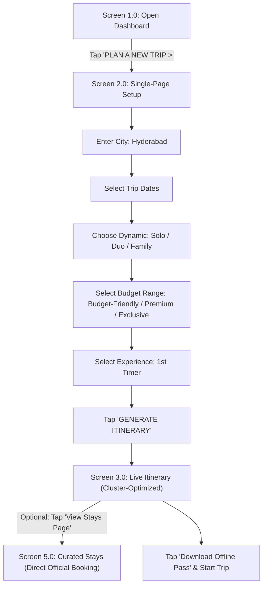
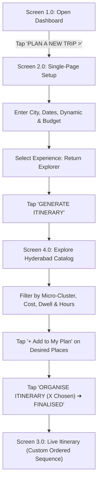
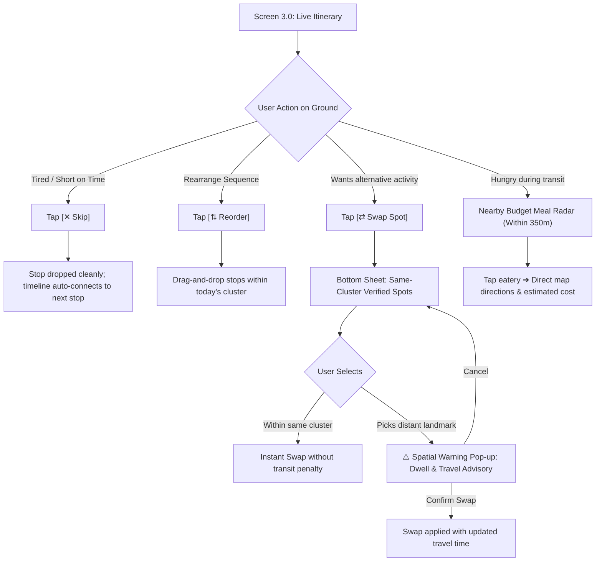
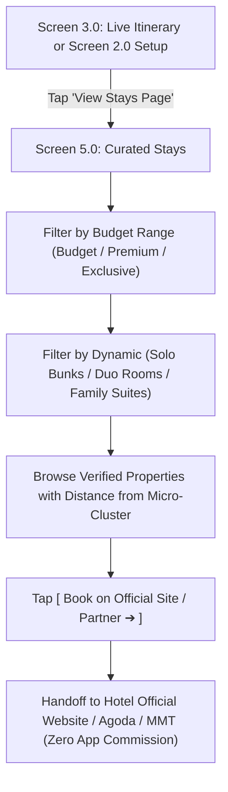
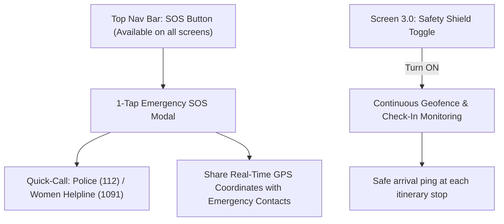

# Phase 4: Master Summary & Outputs Reference Document

**Project Title:** Hyderabad & Telangana Hyper-Local, Budget-Intelligent Trip Planner  
**Creative Director & Product Lead:** NIFT Hyderabad  
**Technical Project Architect:** AGY  
**Lifecycle Stage:** Phase 4 — User Flows & Low-Fidelity Wireframes (Master Outputs)  
**Document Purpose:** Central master reference for all low-fidelity structural wireframes, user task flows, interaction states, and screen architectures established during Phase 4.

---

## 1. Executive Summary & Phase 4 Milestone Achievements

In Phase 4, the Information Architecture from Phase 3 was translated into **concrete, low-fidelity structural screen layouts and task flows**. Every screen has been directly designed from the Creative Director’s hand-drawn sketches and real-time design steering.

### Key Accomplishments:
1. **Official Nomenclature Unification:** Formally locked the active execution screen name to **"Live Itinerary"** (replacing "Active Day Pass").
2. **Single-Page Planning Architecture (Screen 2.0):** Eliminated multi-step friction by consolidating Destination, Dates, Traveler Dynamic, Expandable Two-Tier Budget Selection, and Experience Choice into a single, intuitive setup screen.
3. **Streamlined Intra-Day Interaction (Screen 3.0):** Integrated modification controls (`Reorder`, `Skip`, `Swap Spot` with Spatial Advisory Warning) as lightweight **inline bottom sheets and overlays** directly over the Live Itinerary thread, avoiding fragmented navigation.
4. **Return Explorer Manual Workspace (Screen 4.0):** Built a dedicated catalog with 4-D filter pills, search bar, 2-column destination cards, and an itinerary assembly drawer for returning travelers.
5. **Dedicated Curated Stays Screen (Screen 5.0):** Created a standalone accommodations finder categorized by Budget Range and Traveler Dynamic, featuring direct 1-tap links to official hotel booking sites (zero commissions).
6. **End-to-End User Task Flows:** Mapped out 5 complete decision trees covering 1st-timers, return explorers, live on-ground adjustments, safety SOS, and stay booking.

---

## 2. Master Screen Inventory

| Screen ID | Screen Name | Core Functionality | Primary Actions |
| :--- | :--- | :--- | :--- |
| **Screen 1.0** | **Open Dashboard (Home Screen)** | Unhurried landing hub with trip hero, live status, and recommendation grid | • Tap `PLAN A NEW TRIP >`<br>• Tap `🔴 LIVE ITINERARY` status tile<br>• 1-Tap `SOS`<br>• Browse recommendation cards |
| **Screen 2.0** | **Plan a New Trip (Single-Page Setup)** | Unified trip configuration wizard with expandable budget tiers | • Search City<br>• Select Departure & Return Dates<br>• Select Dynamic (`Solo`, `Duo`, `Family`)<br>• Expand Budget Range (`Budget-Friendly`, `Premium`, `Exclusive`)<br>• Choose Experience (`1st Timer` vs. `Return Explorer`)<br>• Tap `GENERATE ITINERARY` |
| **Screen 3.0** | **Live Itinerary (Timeline Execution)** | Step-by-step ground navigation companion with spatial micro-clusters | • View timeline nodes, dwell times & fees<br>• `[⇅ Reorder]` stops<br>• `[✕ Skip]` next stop<br>• `[⇄ Swap Spot]` (with spatial warning pop-up)<br>• Nearby Budget Meal Radar (within 350m)<br>• `[🏨 View Stays Page]` quick link<br>• Offline Pass Saved badge & Safety Shield toggle |
| **Screen 4.0** | **Explore Hyderabad (Manual Self-Planner)** | Freeform discovery catalog for returning visitors | • Search & 4-D filter pills (Zone, Cost, Dwell, Hours)<br>• 2-column place cards with photo, rating & dwell tags<br>• Bookmark & `[ + Add to My Plan ]`<br>• Sticky Bottom Bar: `ORGANISE ITINERARY (X Chosen) ➔ FINALISED` |
| **Screen 5.0** | **Curated Stays (Accommodations Finder)** | Dedicated verified lodging discovery filtered strictly by budget and party size | • Filter by Budget Tier (`Budget-Friendly`, `Premium`, `Exclusive`)<br>• Filter by Traveler Dynamic (`Solo Hostels`, `Duo Rooms`, `Family Suites`)<br>• Verified listings with distance from core cluster<br>• `[ Book on Official Site / Agoda ➔ ]` (Direct booking handoff) |

---

## 3. Structural Wireframe Layouts

### Screen 1.0: Open Dashboard (Home Screen)
```
┌────────────────────────────────────────────────────────┐
│  ☰   [Profile / Avatar]                       ( SOS )  │
├────────────────────────────────────────────────────────┤
│                                                        │
│   WHERE WOULD YOU LIKE TO GO?                          │
│   [ Search destination...                            ] │
│                                                        │
│  ┌──────────────────────────────────────────────────┐  │
│  │  🔴 LIVE ITINERARY                               │  │
│  │  NEXT: Chowmahalla Palace • 11:30 AM             │  │
│  └──────────────────────────────────────────────────┘  │
│                                                        │
│  ┌──────────────────────────────────────────────────┐  │
│  │                                                  │  │
│  │   PLAN A NEW TRIP                            >   │  │
│  │   Build your hyper-local, budget-smart plan      │  │
│  │                                                  │  │
│  └──────────────────────────────────────────────────┘  │
│                                                        │
│   POPULAR RECOMMENDATIONS                              │
│  ┌──────────────┐  ┌──────────────┐  ┌──────────────┐  │
│  │ TRIP TO GOA  │  │ TRIP TO BALI │  │ TRIP TO...   │  │
│  │ Beaches &    │  │ Culture &    │  │ Heritage &   │  │
│  │ Sunset Trails│  │ Rice Terraces│  │ Hills        │  │
│  └──────────────┘  └──────────────┘  └──────────────┘  │
│                                                        │
├────────────────────────────────────────────────────────┤
│      [ 🏠 HOME ]                     [ 📁 SAVED ]       │
└────────────────────────────────────────────────────────┘
```

---

### Screen 2.0: "Plan a New Trip" Screen (Single-Page Setup)
```
┌────────────────────────────────────────────────────────┐
│  ← Back                                                │
├────────────────────────────────────────────────────────┤
│                                                        │
│  [ 🔍 SEARCH CITY (e.g. Hyderabad)                   ] │
│                                                        │
│  ┌───────────────────────┐   ┌───────────────────────┐ │
│  │ DEPARTURE DATE        │   │ RETURN DATE           │ │
│  │ [ 18 Oct 2026 ]       │   │ [ 21 Oct 2026 ]       │ │
│  └───────────────────────┘   └───────────────────────┘ │
│                                                        │
│  TRAVELLER TYPE                                        │
│  ┌──────────────┐  ┌──────────────┐  ┌──────────────┐  │
│  │  [ SOLO ]    │  │  [ DUO ]     │  │ [ FAMILY ]   │  │
│  └──────────────┘  └──────────────┘  └──────────────┘  │
│                                                        │
│  SELECT BUDGET RANGE                                   │
│  ┌──────────────────────────────────────────────────┐  │
│  │  Budget Friendly                              >  │  │
│  │  (Sub-ranges: Range 1 | Range 2 | Range 3)       │  │
│  └──────────────────────────────────────────────────┘  │
│  ┌──────────────────────────────────────────────────┐  │
│  │  Premium                                      >  │  │
│  │  (Sub-ranges: Range 1 | Range 2 | Range 3)       │  │
│  └──────────────────────────────────────────────────┘  │
│  ┌──────────────────────────────────────────────────┐  │
│  │  Exclusive                                    >  │  │
│  │  (Sub-ranges: Range 1 | Range 2 | Range 3)       │  │
│  └──────────────────────────────────────────────────┘  │
│                                                        │
│  EXPERIENCE CHOICE                                     │
│  ┌───────────────────────┐   ┌───────────────────────┐ │
│  │  1st Timer            │   │  Return Explorer      │ │
│  │  (Guided Auto-Plan)   │   │  (Manual Self-Planner)│ │
│  └───────────────────────┘   └───────────────────────┘ │
│                                                        │
│  ┌──────────────────────────────────────────────────┐  │
│  │              GENERATE ITINERARY                  │  │
│  └──────────────────────────────────────────────────┘  │
└────────────────────────────────────────────────────────┘
```

---

### Screen 3.0: "Live Itinerary" Screen (With Inline Intra-Day Controls)
```
┌────────────────────────────────────────────────────────┐
│  ←       Live Itinerary                    🗺️   ⋮      │
│          Old City Heritage Day                         │
├────────────────────────────────────────────────────────┤
│                                                        │
│  [ Day 1: Charminar Cluster ]   [ Day 2 ]   [ Day 3 ]  │
│                                                        │
│  ┌───────────────────────┬──────────────────────────┐  │
│  │ 🏨 View Stays Page    │ 📥 Offline Pass Saved    │  │
│  │ (Budget Match)        │ 🛡️ Safety Shield [ON]    │  │
│  └───────────────────────┴──────────────────────────┘  │
│                                                        │
│   :                                                    │
│  (1)── ┌────────────────────────────────────────────┐  │
│   │    │ [Photo]  Charminar & Laad Bazaar        🔖 │  │
│   │    │          Heritage • Shopping • Culture     │  │
│   │    │                                            │  │
│   │    │  ⏱️ Dwell: 1.5 hrs        🎟️ ₹25 Entry      │  │
│   │    │  🟢 Open Now • Closes 5:30 PM              │  │
│   │    ├────────────────────────────────────────────┤  │
│   │    │ [ ⇅ Reorder ]   [ ⇄ Swap Spot ]   [ ✕ Skip]│  │
│   │    └────────────────────────────────────────────┘  │
│   :                                                    │
│  ┌──────────────────────────────────────────────────┐  │
│  │ 🍽️  Feeling Hungry?                              │  │
│  │     Nearby Budget Meal Radar (Within 350m)       │  │
│  │                                                  │  │
│  │   ┌────────────────────┐   ┌─────────────────┐   │  │
│  │   │ Cafe 555           │   │ Shadab Biryani  │ > │  │
│  │   │ Irani Chai         │   │ Non-Veg         │   │  │
│  │   │ ₹50 - ₹120         │   │ ₹150 - ₹300     │   │  │
│  │   └────────────────────┘   └─────────────────┘   │  │
│  └──────────────────────────────────────────────────┘  │
│   :                                                    │
│  (2)── ┌────────────────────────────────────────────┐  │
│   │    │ [Photo]  Chowmahalla Palace             🔖 │  │
│   │    │          Royal • Architecture • History    │  │
│   │    │                                            │  │
│   │    │  [ 🚶 12 min walk (900m) ]                 │  │
│   │    │  ⏱️ Dwell: 2.0 hrs        🎟️ ₹100 Entry     │  │
│   │    │  🟢 Open Now • Closes 5:00 PM              │  │
│   │    ├────────────────────────────────────────────┤  │
│   │    │ [ ⇅ Reorder ]   [ ⇄ Swap Spot ]   [ ✕ Skip]│  │
│   │    └────────────────────────────────────────────┘  │
│   :                                                    │
└────────────────────────────────────────────────────────┘

[INLINE STATE CONTROLS OVER SCREEN 3.0]:
• Tapping [⇄ Swap Spot] ➔ Bottom Sheet slides up with Same-Cluster Recommendations.
• Selecting Distant Spot ➔ Overlay alert: "⚠️ Spatial Advisory: Golconda is 14 km away (~45m transit). Proceed?"
• Tapping [✕ Skip] ➔ Removes stop and smoothly reconnects timeline to next stop.
```

---

### Screen 4.0: "Explore Hyderabad" Screen (Return Explorer — Manual Self-Planner)
```
┌────────────────────────────────────────────────────────┐
│  Explore Hyderabad                                     │
│  Discover more. Plan better.                           │
├────────────────────────────────────────────────────────┤
│                                                        │
│  [ 🔍 Search monuments, cafes, gardens...         🎛️ ] │
│                                                        │
│  FILTER PILLS ROW (Horizontal Scroll):                 │
│  [● Old City Zone] [Hitec City] [Under ₹100] [Dwell<2h]│
│                                                        │
│  PLACES GRID (2-Column Layout):                        │
│  ┌────────────────────────┐  ┌───────────────────────┐ │
│  │ [Image]        [🔖]   │  │ [Image]        [🔖]  │ │
│  │ 🟢 Open Now            │  │ 🟢 Open Now           │ │
│  │ Qutb Shahi Tombs       │  │ Golconda Fort         │ │
│  │ Heritage • History     │  │ Heritage • History    │ │
│  │ 🎟️ ₹25    🚶 18m walk  │  │ 🎟️ ₹75   🚗 20m drive │ │
│  │ [Dwell: 1.5h] [ToliCh.]│  │ [Dwell: 2h]  [Golcon.]│ │
│  │ ⭐ 4.4 (2.8k)          │  │ ⭐ 4.6 (4.2k)         │ │
│  │ [ + Add to My Plan ]   │  │ [ + Add to My Plan ]  │ │
│  └────────────────────────┘  └───────────────────────┘ │
│  ┌────────────────────────┐  ┌───────────────────────┐ │
│  │ [Image]        [🔖]   │  │ [Image]        [🔖]  │ │
│  │ 🟢 Open Now            │  │ 🟢 Open Now           │ │
│  │ Salar Jung Museum      │  │ Mecca Masjid          │ │
│  │ Museum • Art • Culture │  │ Heritage • Faith      │ │
│  │ 🎟️ ₹60    🚗 12m drive │  │ 🎟️ ₹10    🚶 15m walk │ │
│  │ [Dwell: 2h]  [Daruss.] │  │ [Dwell: 1h]  [OldCity]│ │
│  │ ⭐ 4.5 (3.1k)          │  │ ⭐ 4.3 (1.9k)         │ │
│  │ [ + Add to My Plan ]   │  │ [ + Add to My Plan ]  │ │
│  └────────────────────────┘  └───────────────────────┘ │
│                                                        │
├────────────────────────────────────────────────────────┤
│  [ 🧭 ORGANISE ITINERARY (4 Selected) ➔ FINALISED ]    │
└────────────────────────────────────────────────────────┘
```

---

### Screen 5.0: Dedicated "Curated Stays" Screen (Accommodations Finder)
```
┌────────────────────────────────────────────────────────┐
│  ← Back    Curated Stays in Hyderabad             🔍   │
│            Pre-verified, clean & budget-matched        │
├────────────────────────────────────────────────────────┤
│                                                        │
│  FILTER BY BUDGET TIER:                                │
│  [● Budget-Friendly]   [Premium]   [Exclusive Luxury]  │
│                                                        │
│  FILTER BY TRAVELER TYPE:                              │
│  [● Solo (Hostels/Bunks)]  [Duo (Rooms)]  [Family (Suites)]│
│                                                        │
│  STAYS FEED:                                           │
│  ┌──────────────────────────────────────────────────┐  │
│  │ [Photo: Interior / Clean Room]               🔖  │  │
│  │                                                  │  │
│  │ Zostel Hyderabad (Abids / Old City Hub)          │  │
│  │ ⭐ 4.6 (1.2k Reviews) • 2.2 km from Charminar    │  │
│  │                                                  │  │
│  │ 🏷️ Backpacker Bunk • Female/Mixed Dorms          │  │
│  │ ✨ Fast Wi-Fi • Clean Sanitized Washrooms • AC   │  │
│  │                                                  │  │
│  │ 💰 ₹799 / night                                  │  │
│  │ [ Book on Official Site / Agoda ➔ ]              │  │
│  └──────────────────────────────────────────────────┘  │
│                                                        │
│  ┌──────────────────────────────────────────────────┐  │
│  │ [Photo: Heritage Courtyard Guesthouse]       🔖  │  │
│  │                                                  │  │
│  │ Heritage Haveli Guesthouse (Lakdikapul)          │  │
│  │ ⭐ 4.5 (890 Reviews) • Central Transit Hub       │  │
│  │                                                  │  │
│  │ 🏷️ Private Deluxe Room • 24/7 Security           │  │
│  │ ✨ Spacious Restrooms • Quiet Ambience • Metro   │  │
│  │                                                  │  │
│  │ 💰 ₹1,450 / night                                │  │
│  │ [ Book on Official Site / MMT ➔ ]                │  │
│  └──────────────────────────────────────────────────┘  │
│                                                        │
│  ┌──────────────────────────────────────────────────┐  │
│  │ [Photo: Boutique Business Hotel]             🔖  │  │
│  │                                                  │  │
│  │ The Park Banjara (Banjara Hills / Jubilee Hub)   │  │
│  │ ⭐ 4.7 (2.4k Reviews) • Boutique Luxury          │  │
│  │                                                  │  │
│  │ 🏷️ Premium City View Room • Rooftop Pool         │  │
│  │ ✨ Express Check-in • Concierge • Luxury Linen   │  │
│  │                                                  │  │
│  │ 💰 ₹4,200 / night                                │  │
│  │ [ Book on Official Site / Agoda ➔ ]              │  │
│  └──────────────────────────────────────────────────┘  │
│                                                        │
└────────────────────────────────────────────────────────┘
```

---

## 4. Master User Task Flows

### Flow 1: 1st-Timer Guided Planning Flow


---

### Flow 2: Returning Explorer Manual Self-Planner Flow


---

### Flow 3: In-Trip Real-Time Execution & Intra-Day Modification


---

### Flow 4: Dedicated Stays Discovery & Direct Booking Flow


---

### Flow 5: Opt-In Safety Shield & Emergency SOS


---

## 5. Summary of Phase Gate Validation

* **Alignment with Creative Director's Vision:** 100% matched to hand-drawn sketches (`Home Screen`, `Plan a New Trip`, `Live Itinerary`, `Explore Hyderabad`, and `Curated Stays`).
* **Zero Cross-City Transit Waste:** Spatial cluster guardrails actively warn against unfeasible intra-day jumps.
* **Separation of Concerns:** Stays are housed in their own dedicated discovery screen (Screen 5.0) while micro-adjustments stay inside lightweight modals over Screen 3.0.
* **Stage Gate Readiness:** Phase 4 wireframes and task flows are complete. Ready for locking and progression to **Phase 5: Visual Design System & Tokens**.
