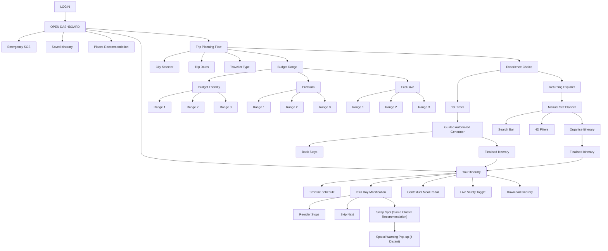

# Master Visual Sitemap Tree (Creative Director's Official Blueprint)

**Project:** Hyderabad & Telangana Hyper-Local Trip Planner  
**Creative Director & Product Lead:** NIFT Hyderabad  
**Technical Project Architect:** AGY  
**Lifecycle Stage:** Phase 3 — Official Visual Sitemap Tree Lock-In  
**Source Document:** Hand-Drawn Sitemap Tree Blueprint (Dated October 2026)

---

## 1. Executive Architecture Overview

The app's Information Architecture follows a clean top-down hierarchy:
* **Entry:** `LOGIN` ➔ `OPEN DASHBOARD`
* **5 Primary Dashboard Branches:**
  1. `Emergency SOS`
  2. `Saved Itinerary`
  3. `Places Recommendation`
  4. `Your Itinerary`
  5. `Trip Planning Flow`

---

## 2. Complete Visual Mermaid Diagram (Exact Hand-Drawn Architecture)

---

## 3. Detailed Node-by-Node Specification

### 3.1 Entry & Onboarding
* **`LOGIN`:** Fast (< 1 min) authentication entry point.
* **`OPEN DASHBOARD`:** Central unhurried landing hub providing instant access to the 5 primary branches.

---

### 3.2 Branch 1: `Emergency SOS`
* Quick-access persistent safety tool offering 1-tap emergency calling (Police 112, Women Helpline 1091) and instant location sharing with trusted contacts.

---

### 3.3 Branch 2: `Saved Itinerary`
* Personal repository housing past completed trips and saved upcoming itineraries.

---

### 3.4 Branch 3: `Places Recommendation`
* Explore and discover curated destinations (starting with Hyderabad, expandable across India).

---

### 3.5 Branch 4: `Your Itinerary` (Active On-The-Ground Guide)
The live companion used by travelers while moving through the city:
1. **`Timeline Schedule`:** Morning-to-evening step-by-step sequence of stops with dwell times.
2. **`Intra Day Modification`:** Real-time on-the-ground flexibility controls:
   * **`Reorder Stops`:** Shift places to-and-fro within today’s schedule.
   * **`Skip Next`:** Drop the immediate next venue cleanly.
   * **`Swap Spot (Same Cluster Recommendation)`:** Replace a place with verified alternatives in the exact same neighborhood.
     * **`Spatial Warning Pop-up (if Distant)`:** Alerts the user if they try to pick a distant place from across the city, warning of transit time before confirming.
3. **`Contextual Meal Radar`:** On-demand dining recommendations nearby matching the selected budget tier.
4. **`Live Safety Toggle`:** User-controlled live tracking for solo/women safety.
5. **`Download Itinerary`:** Offline saved pass to keep the day’s plan accessible without mobile network.

---

### 3.6 Branch 5: `Trip Planning Flow`
The step-by-step configuration wizard:
1. **`City Selector`:** Select destination city (Hyderabad).
2. **`Trip Dates`:** Select arrival date to departure date.
3. **`Traveller Type`:** Choose `Solo Wanderer`, `Duo / Friends`, or `Family Unit`.
4. **`Budget Range` (Two-Tier Structure):**
   * **`Budget Friendly`** ➔ `Range 1`, `Range 2`, `Range 3`
   * **`Premium`** ➔ `Range 1`, `Range 2`, `Range 3`
   * **`Exclusive`** ➔ `Range 1`, `Range 2`, `Range 3`
5. **`Experience Choice`:**
   * **Pathway A: `1st Timer`**
     * ➔ **`Guided Automated Generator`**
     * ➔ **`Book Stays`** (Direct external links to official booking sites)
     * ➔ **`Finalised Itinerary`** ➔ Routes directly into **`Your Itinerary`**
   * **Pathway B: `Returning Explorer`**
     * ➔ **`Manual Self Planner`**
     * ➔ **`Search Bar`** + **`4D Filters`** (Zone, Cost, Dwell, Hours)
     * ➔ **`Organise Itinerary`**
     * ➔ **`Finalised Itinerary`** ➔ Routes directly into **`Your Itinerary`**
